# Experiments

One folder per run, committed so every result can be traced to the code and settings that produced it.

| File | Contents |
|---|---|
| `manifest.json` | Each training session: command, effective settings, git commit, package versions, machine, start and end |
| `training_history.csv` | Training progress, one row per logged batch |
| `evaluations.json` | Per-game scores and max tiles for each evaluated checkpoint, with the commit and environment |
| `NOTES.md` | What was run, how to reproduce it, and what was observed |

Checkpoints aren't committed. Training is deterministic, so the commit and command rebuild them exactly.

Thematic notes for the write-up: [related work](RELATED_WORK.md) and [learning rules: TD, temporal coherence and TD(λ)](learning-rules.md).

```bash
make train-ntuple RUN=my-run ARGS="--games 100000"     # records to experiments/my-run
make watch-ntuple RUN=my-run                           # live chart of that run
uv run python scripts/evaluate.py checkpoints/ntuple/my-run/latest.npz --agent ntuple -n 1000 --experiment experiments/my-run
```

## Runs

| Run | What |
|---|---|
| [`ntuple-td-1m`](ntuple-td-1m/NOTES.md) | N-tuple TD from scratch to 1M games, constant learning rate |
| [`dqn-1m`](dqn-1m/NOTES.md) | The DQN's 1M-step training run |
| [`heuristic-depth2`](heuristic-depth2/NOTES.md) | Hand-crafted heuristic with depth-2 expectimax (no training) |
| [`ntuple-1m-cont-lr0.0025`](ntuple-1m-cont-lr0.0025/NOTES.md) | 1M snapshot trained to 1.5M at the original learning rate (control) |
| [`ntuple-1m-cont-lr0.001`](ntuple-1m-cont-lr0.001/NOTES.md) | 1M snapshot trained to 1.5M at learning rate 0.001 |
| [`ntuple-1m-cont-lr0.0004`](ntuple-1m-cont-lr0.0004/NOTES.md) | 1M snapshot trained to 1.5M at learning rate 0.0004 |
| [`ntuple-1m-cont-lr-decay`](ntuple-1m-cont-lr-decay/NOTES.md) | 1M snapshot trained to 1.5M with the rate decaying from 0.0025 to 0.0001 |
| [`ntuple-1m-cont-tc`](ntuple-1m-cont-tc/NOTES.md) | 1M snapshot trained to 1.5M with temporal coherence learning |
| [`ntuple-tc-1m`](ntuple-tc-1m/NOTES.md) | Temporal coherence from scratch to 1M games, base rate 0.0025 |
| [`ntuple-tc-1m-lr0.01`](ntuple-tc-1m-lr0.01/NOTES.md) | Temporal coherence from scratch to 1M games, base rate 0.01 |
| `screen-*` (9 runs) | [Network screen](#network-screen): layout × temporal coherence rate, from scratch to 200k games |
| `sharing-4x6-*` (4 runs) | [Scale sharing](#scale-sharing): control, late-game starts (C), downgrading (A), downgrading + scale term (B) |
| `threads-4x6-t8-*` (2 runs) | [Multi-threaded training](#multi-threaded-training): lock-free 8-thread training vs single-threaded |
| `seed-4x6-tc0.08-*` (2 runs) | [Seed-to-seed variation](#seed-to-seed-variation): the screen's 4×6 at 0.08 configuration with seeds 7 and 123 |
| `ingredients-4x6-*` (15 runs) | [Ingredient test across seeds](#ingredient-test-across-seeds): control, A, C, A + C and B′, seeds 1–3 |
| `lambda-4x6-*` (9 runs) | [TD(λ) across seeds](#tdλ-across-seeds): Jaśkowski's λ = 0.5, a longer horizon and an annealed λ, on A + C, seeds 1–3 |
| [`long-8x6`](long-8x6/NOTES.md) | [The long run](#the-long-run): 8×6 at 0.02 with A + C, on 8 threads to 1.5M games, then search |
| [`search-long-8x6`](search-long-8x6/NOTES.md) | [Faster search](#faster-search): exact and pruned search at depths 3–6 on the long run's 1.5M network |
| `decision-8x6-*` (4 runs) | [Decision arms](#decision-arms): control, TC reset, constant rate and a larger late-game share, each 1.5M → 2M games from the long run |
| `decision2-8x6-*` (3 runs) | [Decision arms, round 2](#round-2-do-resets-keep-paying): continue, reset again and a gentle reset, each 2M → 2.5M games from round 1's TC reset |
| `decision3-8x6-*` (2 runs) | [Decision arms, round 3](#round-3-optimism-for-never-updated-weights): optimism at 1,000 and 5,000 for never-updated weights, each 2M → 2.5M games from round 1's TC reset |
| [`long-8x6-dg32768`](long-8x6-dg32768/NOTES.md) | [Downgrading from 32768](#downgrading-from-32768-instead-of-16384): the long run from scratch, sharing only the 32768 stage, with evaluations every 250k games |
| [`decision5-8x6-two-stage`](decision5-8x6-two-stage/NOTES.md) | [Decision arms, round 5](#round-5-a-second-stage): a second stage from 16384, copied from the long run's 1.5M network, 1.5M → 2M games |
| `decision6-8x6-*` (2 runs) | [Decision arms, round 6](#round-6-temporal-coherence-with-forgetting): temporal coherence forgetting at 0.999 and 0.9999, each 2M → 2.5M games from round 1's TC reset |
| [`decision11-8x6-rate-0.005`](decision11-8x6-rate-0.005/NOTES.md), [`decision12-8x6-two-stage-reset`](decision12-8x6-two-stage-reset/NOTES.md) | [Round 11](#round-11-a-learning-rate-cut): the rate cut to 0.005; [round 12](#round-12-a-reset-for-the-two-stage-network): round 10's two-stage network with a reset. Both 2M → 2.5M games |
| [`decision8-8x6-two-stage-by-state`](decision8-8x6-two-stage-by-state/NOTES.md), [`decision9-8x6-two-stage-by-state`](decision9-8x6-two-stage-by-state/NOTES.md) | [Rounds 8 and 9](#rounds-8-and-9-a-second-stage-chosen-by-the-board-a-move-is-made-from): the second stage chosen by the board a move is made from, 1.5M → 2M → 2.5M games |
| [`decision10-8x6-two-stage-kept-sums`](decision10-8x6-two-stage-kept-sums/NOTES.md) | [Round 10](#round-10-a-second-stage-without-the-reset): a second stage with the coherence sums kept, 1.5M → 2M games |
| `search-teacher-*` (4 runs) | [Stage 5](#stage-5-search-as-a-teacher): plain TD, search-guided TD and two ranking strengths, each 2M → 2.05M games from round 1's TC reset |
| `late-network-*` (8 runs) | [Stage 6](#stage-6-a-dedicated-late-game-network): a second network for the late game behind the frozen 2M network, from three starts at two rates, 0 → 1–2M continuations, and scratch with a coherence reset |

## Learning at equal experience

1,000 seeded games each, 95% confidence intervals. Experience is the number of moves played during training.

| Agent | Moves trained | Avg score |
|---|---:|---:|
| DQN step_100083 | 0.10M | 2,228 ± 74 |
| N-tuple, 1k games | 0.26M | 4,331 ± 107 |
| DQN step_350068 | 0.35M | 2,631 ± 87 |
| DQN step_625066 | 0.63M | 3,534 ± 108 |
| DQN best | 0.93M | 5,689 ± 170 |
| N-tuple, 3k games | 1.1M | 6,953 ± 168 |
| Heuristic depth 2 | none | 19,981 ± 597 |
| N-tuple, 100k games | 158M | 53,748 ± 1,265 |
| N-tuple, 500k games | 1.55B | 102,693 ± 2,598 |

The n-tuple network learns more from the same experience. At 0.26M moves it beats the DQN at 0.35M by 65% and at 0.63M by 23%, and at 1.1M moves it beats the DQN's best (0.93M) by 22%. It also gathers that experience in about a second on one CPU core, where the DQN's took hours on a GPU, so it can go on to over 1,000 times as much.

## Learning rate after the plateau

`ntuple-td-1m` stops improving after about 500k games at learning rate 0.0025. Three runs resumed its 1M snapshot for another 500k games, identical except for the learning rate. 1,000 seeded games each, 95% confidence intervals:

| Learning rate | 1.25M games | 1.5M games | ≥8192 at 1.5M | ≥16384 at 1.5M |
|---|---:|---:|---:|---:|
| 0.0025 (control) | 103,098 ± 2,647 | 102,220 ± 2,751 | 55.5% | 0% |
| 0.001 | 111,344 ± 2,643 | 113,692 ± 2,684 | 66.5% | 0% |
| 0.0004 | 120,945 ± 2,650 | 118,983 ± 2,664 | 68.9% | 0.4% |

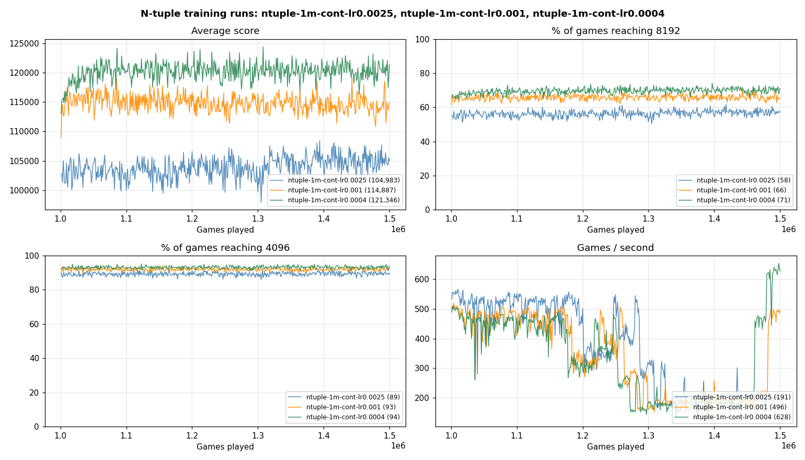

- Lowering the rate to 0.0004 lifts the score by about 17%, at no extra cost.
- The gain appears within a few thousand games of the change, then each rate settles on its own plateau: 1.25M and 1.5M are level within noise for all three.
- That pattern suggests the original rate kept the weights noisy rather than stopped them learning. A schedule that keeps decaying, or a per-weight adaptive rate, is the natural next test.

## Learning-rate methods

Two more continuations from the same 1M snapshot and seed: a rate that keeps decaying (0.0025 to 0.0001, geometrically) and temporal coherence (per-weight rates, base 0.0025). 1,000 seeded games each, 95% confidence intervals:

| Method | 1.25M games | 1.5M games | ≥8192 at 1.5M | ≥16384 at 1.5M |
|---|---:|---:|---:|---:|
| Constant 0.0025 (control) | 103,098 ± 2,647 | 102,220 ± 2,751 | 55.5% | 0% |
| Constant 0.0004 | 120,945 ± 2,650 | 118,983 ± 2,664 | 68.9% | 0.4% |
| Decay 0.0025 → 0.0001 | 122,626 ± 2,626 | 123,723 ± 2,551 | 73.4% | 0.4% |
| Temporal coherence | 126,803 ± 2,613 | 128,208 ± 2,640 | 74.2% | 0.7% |

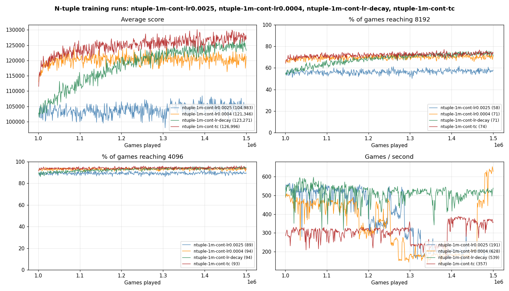

- Temporal coherence is best at both snapshots: 25% above the control and about 8% above the best constant rate. It needs no rate to be tuned, gets there within a few thousand games, and was still creeping up at 1.5M.
- The decaying rate catches up as it falls, finishing about 4% above the best constant rate. Going below 0.0004 helps a little, not a lot.
- Temporal coherence costs about a third of training speed and triples the checkpoint size.

## Temporal coherence from scratch

Two runs trained from scratch with temporal coherence, using the same seed and snapshots as `ntuple-td-1m` (constant rate 0.0025). 1,000 seeded games per snapshot, 95% confidence intervals, with the moves each had trained on:

| Games | Constant 0.0025 | TC, base 0.0025 | TC, base 0.01 |
|---:|---:|---:|---:|
| 1k | 4,331 ± 107 (0.3M moves) | 4,625 ± 114 (0.3M) | 7,381 ± 178 (0.4M) |
| 3k | 6,953 ± 168 (1.1M) | 6,884 ± 165 (1.1M) | 11,218 ± 272 (1.6M) |
| 10k | 10,648 ± 254 (5.0M) | 10,790 ± 262 (5.2M) | 18,504 ± 465 (7.6M) |
| 100k | 53,748 ± 1,265 (158M) | 32,300 ± 815 (114M) | 77,593 ± 1,760 (236M) |
| 500k | 102,693 ± 2,598 (1.55B) | 84,955 ± 2,028 (1.35B) | 120,918 ± 2,633 (2.09B) |
| 1M | 101,376 ± 2,582 (3.69B) | 112,398 ± 2,633 (3.47B) | 125,498 ± 2,498 (4.71B) |

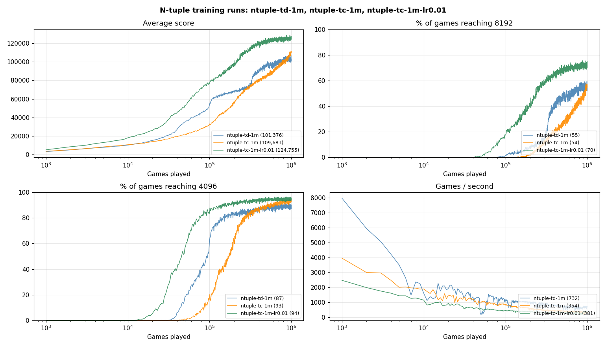

- With the same base rate, temporal coherence learns more slowly through the middle of training (32k vs 54k at 100k games), because it can only lower each weight's rate and many weights' errors disagree early on. It overtakes by 1M games (112k vs 101k) and was still rising, where the constant rate had plateaued.
- With a 4x higher base rate, temporal coherence is ahead at every snapshot: it reaches the constant run's final level in about 250k games and finishes at 125k, on par with the best continuation runs, in a single from-scratch run with no rate schedule.
- It also wins on experience, not just games: 7,381 after 0.4M moves, above the constant run at 1.1M (6,953) and the DQN's best at 0.93M (5,689 ± 170).
- Taken with the continuation runs, temporal coherence works best as a safety brake on an aggressive rate rather than on an already careful one.

## Expectimax search on the n-tuple network

`ntuple_search` plays by expectimax: each move is worth its reward plus the expected value over every possible tile spawn, down to a fixed depth, where the network values the afterstate. Depth 1 is the greedy agent. No retraining is involved. Evaluated on the two strongest networks, 1,000 seeded games each, 95% confidence intervals:

| Network | Greedy | Depth 2 | Depth 3 | ≥8192 at depth 3 | ≥16384 at depth 3 |
|---|---:|---:|---:|---:|---:|
| [`ntuple-tc-1m-lr0.01`](ntuple-tc-1m-lr0.01/NOTES.md), 1M games | 125,498 ± 2,498 | 153,946 ± 1,631 | 162,469 ± 1,497 | 97.4% | 2.4% |
| [`ntuple-1m-cont-tc`](ntuple-1m-cont-tc/NOTES.md), 1.5M games | 128,208 ± 2,640 | 167,654 ± 2,657 | 202,291 ± 3,457 | 98.9% | 42.6% |

- Search adds 30-58% at depth 3. Nearly every game reaches 8192, against about 72% greedy.
- The networks are level when greedy but split apart under search. With depth 3, the one trained for 1.5M games reaches 16384 in 43% of games, against 2% for the 1M-game network. Greedy play rarely survives long enough for the 16384-stage weights to matter, so greedy evaluation understates the value of longer training.
- Search is cheap: a depth-3 game takes about 3 seconds alone, or 6 per core with all cores busy, mostly in the Python game engine. Depth 4 takes about 70 seconds alone.

## Network screen

Which network layout and learning rate learn most from a small budget? Nine runs from scratch to 200k games, all with temporal coherence and the same seed. The 8×6 layout reads 64 weights per board against 32 for the others, so a given per-weight rate takes twice the total step on it. 1,000 seeded greedy games per snapshot, 95% confidence intervals:

| Run | 50k games | 100k games | 200k games | ≥8192 | ≥16384 | Moves to 200k |
|---|---:|---:|---:|---:|---:|---:|
| [ours (2×4 + 2×6), 0.01](screen-2x4-2x6-tc0.01/NOTES.md) | 52,734 ± 1,210 | 77,593 ± 1,760 | 98,747 ± 2,402 | 43.2% | 0% | 626M |
| [4×6, 0.005](screen-4x6-tc0.005/NOTES.md) | 44,827 ± 1,251 | 58,771 ± 1,717 | 77,182 ± 2,218 | 20.9% | 0% | 522M |
| [4×6, 0.01](screen-4x6-tc0.01/NOTES.md) | 58,469 ± 1,733 | 76,492 ± 2,212 | 106,255 ± 2,886 | 49.1% | 1.1% | 671M |
| [4×6, 0.02](screen-4x6-tc0.02/NOTES.md) | 73,743 ± 2,177 | 100,020 ± 2,903 | 129,929 ± 3,319 | 66.6% | 2.8% | 817M |
| [4×6, 0.04](screen-4x6-tc0.04/NOTES.md) | 91,223 ± 2,522 | 119,353 ± 3,135 | 149,304 ± 4,042 | 74.1% | 13.4% | 949M |
| [4×6, 0.08](screen-4x6-tc0.08/NOTES.md) | 109,077 ± 2,904 | 132,332 ± 3,317 | 154,758 ± 4,066 | 77.4% | 14.9% | 1,030M |
| [8×6, 0.005](screen-8x6-tc0.005/NOTES.md) | 70,572 ± 2,032 | 97,973 ± 2,949 | 131,314 ± 3,651 | 63.2% | 5.0% | 809M |
| [8×6, 0.01](screen-8x6-tc0.01/NOTES.md) | 92,877 ± 2,817 | 128,754 ± 3,721 | 172,244 ± 5,167 | 78.2% | 26.8% | 1,017M |
| [8×6, 0.02](screen-8x6-tc0.02/NOTES.md) | 121,046 ± 3,376 | 165,418 ± 4,568 | **205,447 ± 5,807** | **86.7%** | **41.2%** | 1,244M |

The ≥8192 and ≥16384 columns are at 200k games.

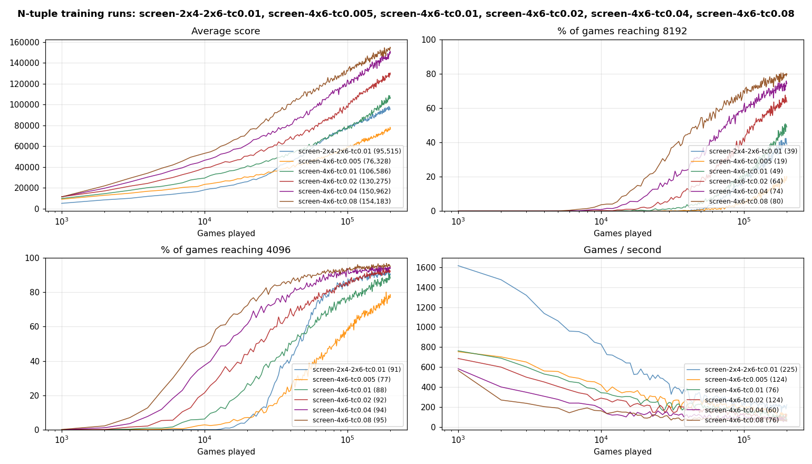
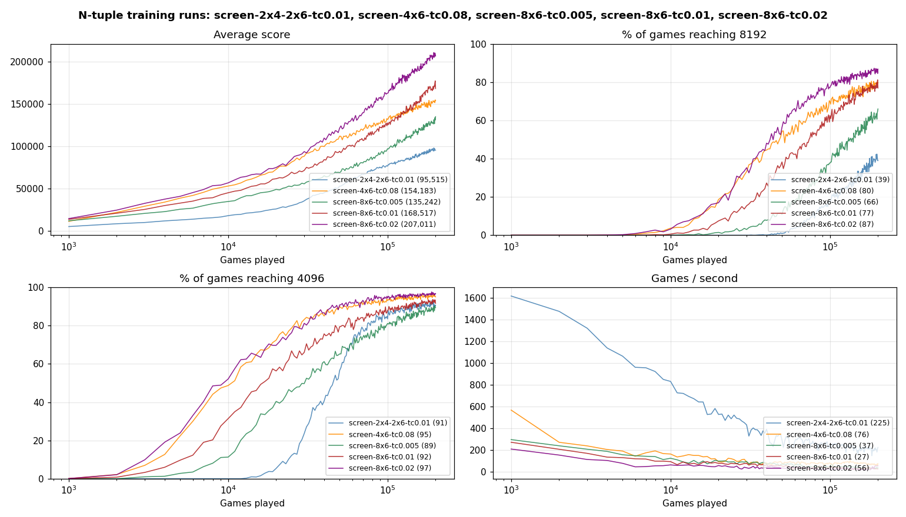

- **Bigger layouts learn more per game.** At the same total step (8×6 at 0.01 vs 4×6 at 0.02), 8×6 scores 33% more at 200k games.
- **Higher rates win at this budget.** Each doubling helped up to 0.04–0.08 on 4×6, where gains flatten. Temporal coherence keeps the high rates stable.
- **The 8×6 at 0.02 beats Yeh et al.'s 159,565 greedy (15M games) by 29% after 200k games,** and matches this project's earlier best agent *with* depth-3 search. Playing greedily, it reaches 16384 in 41% of games. It was still climbing steeply at 200k.
- **Cost:** 8×6 trains at roughly a third of 4×6's speed. With up to seven runs sharing the machine, these runs' games/s aren't representative of solo speed.

## Scale sharing

Published comparisons are in [RELATED_WORK.md](RELATED_WORK.md). The weakness they point to is the late game: n-tuple weights are indexed by exact tile values, so a 16384-8192-4096 chain and an 8192-4096-2048 chain share nothing, and the rare late-game positions leave their weights undertrained.

**The property all three designs rely on.** Suppose a board is missing some tile value below its largest tile (a gap). Doubling every tile above the gap, or halving it, gives a board with the same legal moves, merges and slides. Equal big tiles stay equal, and the new values land on the missing one, so they can't match a small tile. Only the rewards for merging big tiles change, and only until a small-tile merge fills the gap. Guei uses halving ("tile-downgrading") at play time only.

| Design | Idea | Main risk |
|---|---|---|
| A. Downgraded learning | Past a threshold, the network reads and trains on the halved board, reusing well-trained smaller-scale weights | Positions with different true returns share one value |
| B. A + scale term | As A, plus a small table indexed by how many tiles of each large size the real board has (Yeh's large-tile feature), so patterns are shared and the scale term learns the value offset | More to tune |
| C. Synthetic late-game starts | Double the tiles above a gap in positions from ordinary play to make valid larger-scale positions, and start some training games from them. Learning itself stays exact. | Synthetic positions may not match those reached in play |

The order is C, then B: C is the safest and answers "does more late-game experience help", and B is the most novel (it's Guei's proposed future work). A is B without the scale term, so it serves as B's ablation. Each is tested at 200–500k games against the best configuration from the network screen.

### Results

The 4×6 network with temporal coherence at base rate 0.08, four runs from scratch to 300k games with the same seed, differing only in the feature tested. 1,000 seeded greedy games per snapshot. The difference from the control is a paired per-game comparison on the same seeds, with a 95% confidence interval:

| Run | 100k | 200k | 300k | ≥16384 at 300k | vs control at 300k | Moves to 300k |
|---|---:|---:|---:|---:|---:|---:|
| [Control](sharing-4x6-control/NOTES.md) | 132,332 | 154,758 | 172,077 ± 4,519 | 24.4% | — | 1.69B |
| [**A: downgrading**](sharing-4x6-downgrade/NOTES.md) | 135,726 | 155,669 | **181,790 ± 5,015** | 27.5% | **+9,714 ± 6,729** | 1.72B |
| [C: late-game starts](sharing-4x6-late-starts/NOTES.md) | 133,603 | 157,741 | 177,324 ± 5,140 | **28.5%** | +5,247 ± 6,830 | **1.55B** |
| [B: downgrading + scale term](sharing-4x6-downgrade-scale/NOTES.md) | 113,764 | 144,132 | 163,073 ± 5,116 | 23.2% | −9,004 ± 6,886 | 1.55B |

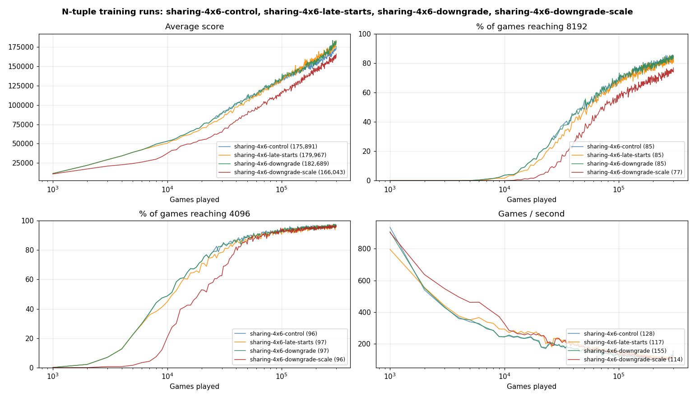

- **Downgrading (A) helps: +5.6% at 300k, significant at 95%.** It also raises the 16384 rate, and produced the only 32768 tile in these evaluations. It tracks the control until 16384 tiles appear, then pulls ahead. This is Guei's proposed future work (downgrading during training), and the first evidence that it pays off.
- **Late-game starts (C) look positive but aren't conclusive:** +3.0%, with the interval still including zero. They also used 9% fewer moves than the control for the same number of games, since synthetic games start mid-game, so per unit of experience C is somewhat stronger than its score suggests. It has the highest 16384 rate.
- **The scale term (B) hurts: −5.2%, significant.** B falls behind from the very first thousand games, before any large tile exists. That rules out downgrading as the cause, and points to the scale table's "no large tiles" entry acting as one shared bias weight updated at the full rate. A version that skips that entry, or gives the table its own lower rate, is untested.
- Training is deterministic: an earlier run of the same script on an identical machine reached exactly the same 300k training averages for all four runs. That attempt's records were discarded, because a smoke test with the same run names overlapped it. The script now refuses to start a run that's already training, and smoke tests use separate `smoke-*` names.

### Running it

```bash
uv sync
scripts/run_scale_sharing.sh                              # about 1.5–2 hours on a 10-core M4
GAMES=3000 EVAL_GAMES=20 scripts/run_scale_sharing.sh     # smoke test as separate smoke-* runs, about a minute
make watch-ntuple ARGS="--run sharing-4x6-control sharing-4x6-late-starts sharing-4x6-downgrade-scale sharing-4x6-downgrade"
```

The runs need about 1 GB of RAM each and about 13 GB of disk for checkpoints (`checkpoints/` is gitignored).

## Multi-threaded training

`NTUPLE_THREADS=n` plays games on n threads that update the shared weights without locks, as in Jaśkowski (2018). The first `NTUPLE_THREADS_AFTER` games (default 10,000) stay single-threaded, since a fresh network collides often. Threaded runs aren't bit-reproducible.

**Speed.** Measured from a 200k-game snapshot of the 4×6 network with temporal coherence:

| Threads | 1 | 2 | 4 | 8 |
|---|---:|---:|---:|---:|
| Moves/s | 1.06M | 2.17M | 3.86M | 5.04M |
| Speed-up | 1× | 2.0× | 3.6× | 4.8× |

Scaling is near-linear up to the M4's 4 performance cores, and threads beyond that land on efficiency cores. Each 200k-game threaded run took about 3.5 minutes.

These runs used numba's parallel loops (commits up to `7f28a17`). Those can't compile layouts with scale sharing, so threading now runs the GIL-free game loop on plain threads, handing out small shares of each batch as threads free up. On the same 200k-game network and 1,000-game batch, both versions reach the same speed on 8 threads: 3.99M moves/s for the new one, 3.93–3.98M for the old. The table above comes from a different measurement, timing training batches, so it isn't directly comparable.

**Quality.** Two 8-thread runs, A and B, of the 4×6 at rate 0.08 to 200k games, against the single-threaded [`screen-4x6-tc0.08`](screen-4x6-tc0.08/NOTES.md). 1,000 seeded greedy games each. The difference is paired per game on the same seeds:

| Run | 100k games | 200k games | ≥16384 at 200k | vs single-threaded at 200k |
|---|---:|---:|---:|---:|
| Single-threaded | 132,332 ± 3,317 | 154,758 ± 4,066 | 14.9% | — |
| [8 threads, A](threads-4x6-t8-a/NOTES.md) | 134,380 ± 3,376 | 154,931 ± 3,847 | 13.4% | +172 ± 5,649 |
| [8 threads, B](threads-4x6-t8-b/NOTES.md) | 131,040 ± 3,450 | 146,648 ± 3,594 | 8.9% | −8,110 ± 5,328 |

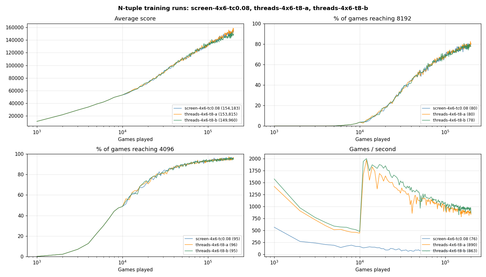

- Run A matches single-threaded training. Run B is about 5% lower at 200k, beyond evaluation noise.
- A and B differ only by chance, in the order threads touched the weights and in each thread's random games, yet they differ from each other by as much as B does from the single-threaded run. So B's deficit may be ordinary run-to-run variation rather than a cost of threading.
- **Resolved by the [seed check](#seed-to-seed-variation): threading costs nothing measurable.** Single-threaded runs with different seeds spread just as widely (148.2k–154.8k at 200k). The average of the two threaded runs is within 900 points of the average of the three single-threaded ones, and B sits just below the lowest seed.
- Smoothed training curves agree. All five runs stay within about 2% of each other up to 100k games, and spread only in the late game, where single-threaded runs also vary. So a longer single-threaded warm-up wouldn't help: the default 10,000 games is enough.

## Seed-to-seed variation

Every other comparison in this archive uses seed 42. To measure how much that matters, the screen's 4×6 at 0.08 configuration was trained single-threaded with seeds 7 and 123 as well. 1,000 seeded greedy games each:

| Run | 100k games | 200k games | ≥16384 at 200k |
|---|---:|---:|---:|
| Seed 42 ([`screen-4x6-tc0.08`](screen-4x6-tc0.08/NOTES.md)) | 132,332 ± 3,317 | 154,758 ± 4,066 | 14.9% |
| [Seed 7](seed-4x6-tc0.08-s7/NOTES.md) | 130,461 ± 3,435 | 152,045 ± 3,961 | 13.2% |
| [Seed 123](seed-4x6-tc0.08-s123/NOTES.md) | 132,397 ± 3,461 | 148,188 ± 3,895 | 11.9% |
| Mean ± standard deviation of seeds | 131,730 ± 1,100 | 151,664 ± 3,301 | |
| 8 threads, A / B | 134,380 / 131,040 | 154,931 / 146,648 | 13.4% / 8.9% |

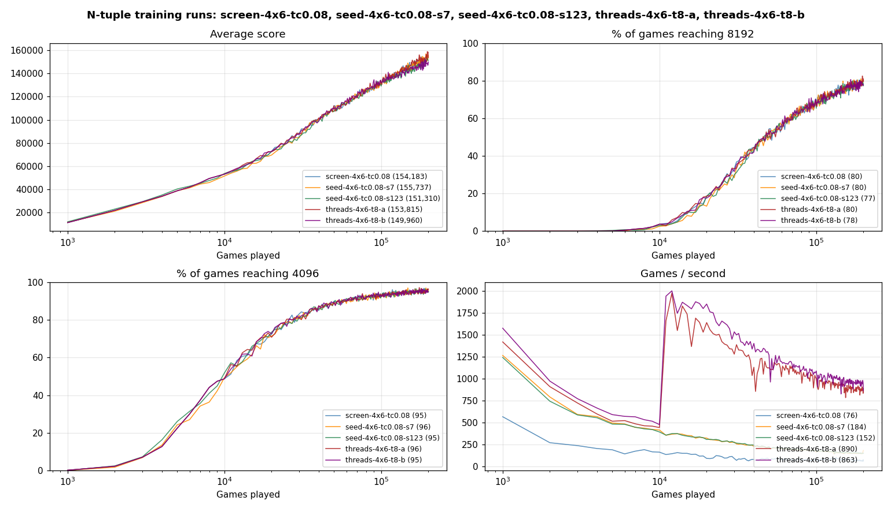

Runs vary by about ±2% between seeds at 200k games (one standard deviation, 3.3k). They agree to within about 1% at 100k and spread as the late game arrives. For the single-seed comparisons elsewhere in this archive:
- **Robust,** well beyond seed variation: bigger layouts and higher rates in the network screen (8×6 is 33% above 4×6 at the same total step), temporal coherence over constant rates, and downgrading (A, +9.7k at 300k, about 3 standard deviations).
- **Not conclusive:** late-game starts (C, +5.2k), 4×6 at 0.08 vs 0.04 (+3.6%), and the earlier single-run learning-rate comparisons where differences are within a few percent.
- Effects of a few percent need several seeds per arm, which multi-threaded training now makes affordable.

## Ingredient test across seeds

The single-seed scale-sharing test left late-game starts (C) inconclusive, and the [seed check](#seed-to-seed-variation) showed single runs vary by about ±2%. So each ingredient was retested with three seeds:
- **The arms:** control, downgrading (A), late-game starts (C), both together (A + C), and B′.
- **B′** is the scale term applied only to downgraded boards, a redesign of B intended to avoid its shared-bias problem.
- **The setup:** the 4×6 at temporal coherence rate 0.08, trained from scratch to 300k games on 8 threads, with seeds 1–3, and evaluated on 1,000 seeded greedy games.

| Arm | Seed 1 | Seed 2 | Seed 3 | Mean of seeds ± sd | vs control (paired by seed) | ≥16384 | Moves |
|---|---:|---:|---:|---:|---:|---:|---:|
| Control | 162,538 | 162,231 | 171,064 | 165,278 ± 5,013 | — | 20.6% | 1.67B |
| A: downgrading | 170,248 | 158,596 | 179,014 | 169,286 ± 10,243 | +4,008 ± 6,621 | 19.8% | 1.67B |
| C: late-game starts | 175,163 | 173,399 | 168,682 | 172,415 ± 3,351 | +7,137 ± 8,276 | 24.9% | 1.52B |
| **A + C** | **186,413** | **186,809** | **187,498** | **186,906 ± 549** | **+21,629 ± 4,513** | **31.2%** | 1.59B |
| B′: downgrading + scale term on downgraded boards | 151,519 | 175,887 | 180,914 | 169,440 ± 15,722 | +4,163 ± 13,284 | 20.4% | 1.69B |

The ≥16384 and moves columns are averages over the three seeds.

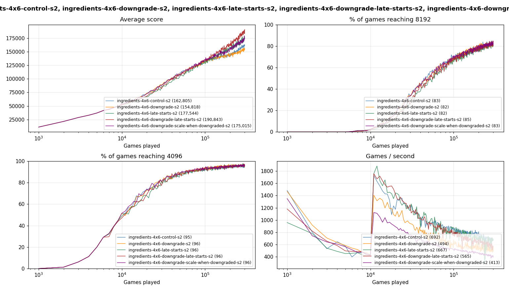

- **A + C is a robust +13%.** All three seeds gain 16–25k, and the mean gain is about 8 standard errors from zero. It also raises the 16384 rate by half, uses fewer moves than the control, and is strikingly consistent: its seeds differ by 1.1k, against 9k for the control.
- **The two ingredients are much stronger together than apart.** Alone, each gives a small gain that isn't consistent across seeds (A +4.0k, C +7.1k). Together they give +21.6k, about twice the sum. A likely mechanism: late-game starts supply the rare late-game experience, and downgrading lets it train weights shared across tile scales, so each synthetic game teaches every scale at once.
- **B′ is erratic** (−11k, +14k, +10k). Restricting the scale term to downgraded boards removed B's early damage, but the few heavily shared scale weights still make late-game learning noisy. It's left out.
- The earlier single-seed results fit this picture. A's +9.7k with seed 42 was above anything seen across these three seeds (−3.6k to +8.0k), so that test happened to land on a favourable seed. C's +5.2k sits within its range.

## TD(λ) across seeds

Jaśkowski (2018) trained with delayed TD(λ): each afterstate's update waits a few moves, then moves towards a blend of the real rewards over the next h moves and the value estimate after them. It's meant to carry information back faster than TD(0)'s one-move lookahead, which suits this project's sample-efficiency goal. This test asks whether it helps here, and whether two variants improve on his setting.

- **The arms:**
  - Close to Jaśkowski's setting: λ = 0.5 with horizon 3. His update sums h + 1 errors, so his h = 3 is horizon 4 here, and this arm is one step shorter.
  - A longer horizon: λ = 0.75 with horizon 6, to carry information further back.
  - Annealed: λ = 0.75 with horizon 6, falling linearly to TD(0) over the session. The idea was to get the fast early learning from long returns and the low noise of TD(0) at the end.
- **The setup:** the A + C recipe from the [ingredient test](#ingredient-test-across-seeds) (the 4×6 at temporal coherence rate 0.08, downgrading and late-game starts), trained from scratch to 300k games on 8 threads with seeds 1–3, and evaluated on 1,000 seeded greedy games. The TD(0) control is that test's A + C arm, which has exactly these settings, so it wasn't retrained.
- **The implementation** keeps the last h afterstates in a ring buffer and updates the oldest once the buffer is full. Whatever is left in the buffer is updated at game end. With horizon 1 it gives bit-identical weights to TD(0), which a test checks.

| Arm | Seed 1 | Seed 2 | Seed 3 | Mean of seeds ± sd | vs TD(0) (paired by seed) | ≥16384 | Moves |
|---|---:|---:|---:|---:|---:|---:|---:|
| **TD(0)** | **186,413** | **186,809** | **187,498** | **186,906 ± 549** | — | **31.2%** | 1.59B |
| Jaśkowski: λ = 0.5, horizon 3 | 154,002 | 155,942 | 157,229 | 155,724 ± 1,624 | −31,182 ± 1,105 | 12.4% | 1.47B |
| Longer horizon: λ = 0.75, horizon 6 | 127,291 | 126,810 | 124,120 | 126,074 ± 1,709 | −60,832 ± 2,247 | 0.9% | 1.17B |
| Annealed: λ = 0.75 → 0, horizon 6 | 153,274 | 158,236 | 153,674 | 155,061 ± 2,757 | −31,845 ± 2,855 | 11.6% | 1.33B |

The ≥16384 and moves columns are averages over the three seeds.

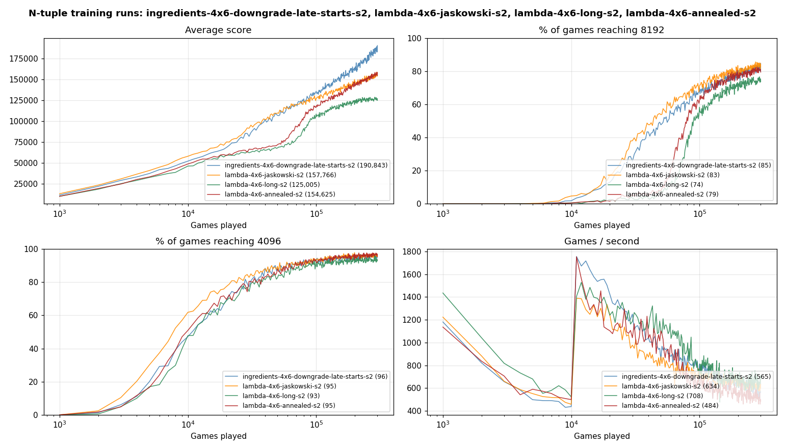

The training average score at points during training is shown below: the mean of the three seeds over the 10,000 games up to each point. Training games include the late-game starts, so these aren't comparable to the evaluations, only to each other.

| Games | TD(0) | Jaśkowski | Longer horizon | Annealed (λ at that point) |
|---:|---:|---:|---:|---:|
| 10k | 36,509 | **40,566** | 32,024 | 32,836 (0.73) |
| 30k | 78,973 | **84,464** | 60,792 | 63,041 (0.68) |
| 50k | 104,078 | **107,025** | 66,747 | 70,119 (0.63) |
| 100k | **131,725** | 127,686 | 94,325 | 102,703 (0.50) |
| 200k | **162,232** | 146,829 | 122,094 | 140,895 (0.25) |
| 300k | **187,380** | 156,207 | 126,411 | 154,851 (0) |

- **TD(λ) hurts at this learning rate and budget, in every variant and on every seed.** The Jaśkowski arm costs 17%, and its three seeds land within 2.2k of each other (−30.3k to −32.4k). The gap isn't explained by the fewer moves played: shorter games are a symptom of weaker play, and TD(0) was already ahead at that point.
- **The Jaśkowski arm learns faster at first, then falls behind.** On all three seeds it's 3.7–7.6k ahead at 10k and 30k games, about level at 70k, and behind from 100k onwards, with the gap still widening at 300k. The early lead is what TD(λ) is meant to give: while the values are poor, real rewards are a better target than the value estimate. Later the estimates are good, and each extra step of real play mostly adds the randomness of another tile spawn. Two likely ways that noise hurts:
  - At base rate 0.08 the noise goes straight into the weights.
  - It makes errors cancel more, so temporal coherence shrinks the rates sooner.
- **A longer horizon is worse at every stage.** Both horizon-6 arms stall at 60–70k between about 20k and 70k games, before 8192 is reached, while TD(0) climbs 25k over the same stretch. The longer-horizon arm almost never reaches 16384 (0.9%).
- **Annealing recovers half the gap, but stops there.** It ends level with the Jaśkowski arm. Even over the last 100k games, with λ down from 0.25 to 0, it gains 14.0k against TD(0)'s 25.1k, so the damage outlasts λ itself. A likely cause: temporal coherence's error sums accumulate over the whole run, so a long noisy phase leaves the rates low after the noise has gone.
- **How this compares with Jaśkowski.** There's no published result to contradict: he chose λ = 0.5 from "informal preliminary experiments" and reports no λ = 0 comparison. The likeliest reason λ fails here is the learning rate. The training budget is less likely, and the horizon doesn't explain it.
  - **Learning rate.** His rate is divided by the number of weights read, and he calls 1.0 "the maximum sensible value", the rate that cancels the whole error in one step. On the 4×6 that's 1/32 ≈ 0.031 per weight. This project's 0.08 can move a value by up to 2.56× its error before temporal coherence slows it, so a noisier target gets amplified.
  - **Training budget.** He trained for 10¹⁰ moves, about 6× this test. But the gap here widened with training, from −4k at 100k games to −31k at 300k, so a longer run would more likely widen it further.
  - **Horizon.** His exact setting, one step longer than this arm, would probably do no better, since the longer horizon did worse here.
- **For the [final training run](#final-training-run), TD(λ) is dropped.** Its only gain is a head start in the first ~70k games, which is minutes of a multi-day run. TD(λ) at lower base rates (0.02–0.04) would test the rate explanation, but it's a low priority.

## The long run

The screen's best layout and rate (8×6, temporal coherence at 0.02) with the ingredient test's best pair, downgrading and late-game starts (A + C). Trained from scratch to 1.5M games on 8 threads with seed 42, in 2 h 02 min on the M4. 1,000 seeded games per evaluation, 95% confidence intervals:

| Games | Moves | Greedy | Median | ≥8192 | ≥16384 | ≥32768 |
|---:|---:|---:|---:|---:|---:|---:|
| 100k | 0.44B | 167,785 ± 5,097 | 167,712 | 76.2% | 20.6% | 0.2% |
| 250k | 1.59B | 244,076 ± 7,054 | 256,096 | 87.8% | 55.3% | 1.9% |
| 500k | 3.87B | 267,705 ± 7,346 | 286,228 | 92.1% | 61.5% | 4.2% |
| 1M | 8.76B | 285,232 ± 7,405 | 314,318 | 92.3% | 68.0% | 4.4% |
| 1.5M | 13.86B | **299,894 ± 7,668** | 339,306 | 92.1% | 73.2% | 6.4% |

With search on the 1.5M network. The gain is paired per game against greedy on the same seeds:

| Agent | Score | Median | vs greedy | ≥16384 | ≥32768 | Time for 1,000 games |
|---|---:|---:|---:|---:|---:|---:|
| Greedy | 299,894 ± 7,668 | 339,306 | — | 73.2% | 6.4% | 5 min |
| Depth 2 | 343,160 ± 6,327 | 373,222 | +43,267 ± 9,629 | 85.8% | 7.2% | 7 min |
| Depth 3 | **365,404 ± 5,769** | 377,960 | +65,510 ± 9,458 | 90.7% | 8.5% | 31 min |

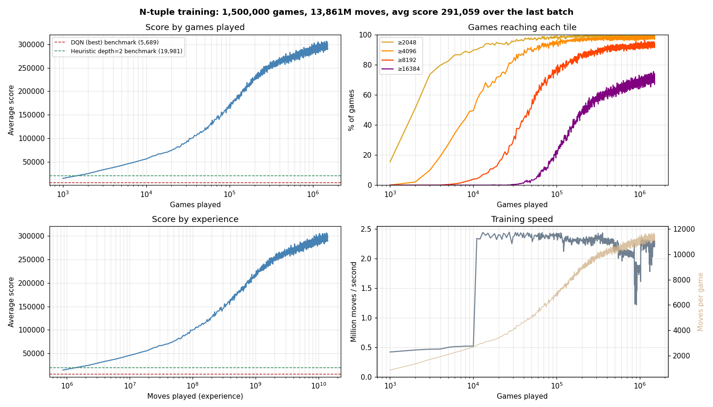

Against the published agents in [RELATED_WORK.md](RELATED_WORK.md):

| Agent | Greedy | 3-ply | Training |
|---|---:|---:|---|
| Guei et al. 2022 (state of the art) | 412,785 | 563,316 | 200M episodes, 66 h on 20 threads |
| Jaśkowski 2018, full method | 324,710 | 511,759 | 4×10¹⁰ moves, 5.5 days on 24 cores |
| **This run** | **299,894** | **365,404** | 1.4×10¹⁰ moves, 2 h on a 10-core laptop |
| Yeh et al. 2016, plain TD | 159,565 | 321,496 | 15M games |
| Jaśkowski 2018, TC only | 248,770 | 333,010 | 10¹⁰ moves, 1.16 days on 24 cores |

- **This is the project's best agent by far: 2.3× the previous best greedy (128k) and 1.8× at depth 3 (202k).**
  - Greedy, it beats every published n-tuple result except Jaśkowski's full method (92% of it) and Guei's (73%).
  - At 3-ply it beats Yeh and Jaśkowski's TC-only network, and reaches 65% of the state of the art.
- **Sample efficiency is where it leads.**
  - At 1M games (8.8×10⁹ moves) it scores 285k greedy, against 249k for Jaśkowski's TC-only network after 10¹⁰ moves.
  - Guei reports that n-tuple networks "could not even achieve 240000 points" after 10¹⁰ moves, and his 4×6 needed 10M episodes to reach 248k.
  - Guei's 8×6 reaches 360–371k greedy after 100M games, so this run reaches 81–83% of that with 1.5% of the games.
- **Still improving at 1.5M, with no sign of temporal coherence stalling.**
  - The paired gains are +17,527 ± 10,259 from 500k to 1M games and +14,662 ± 10,713 from 1M to 1.5M, about +20–25k per doubling of games.
  - The training averages flattened over the last 100k games (+0.7k), but the evaluations don't confirm a plateau, so that was noise.
- **Search helps less than on weaker networks: +22% at depth 3, against +58% for the [earlier 1.5M-game network](#expectimax-search-on-the-n-tuple-network).** Almost every searched game reaches 16384, and depth 3 adds only 4.7k to depth 2's median.
- **The remaining gap is 32768.**
  - Building a 16384 tile with its 8192 and 4096 chain is worth about 380k, which is where the median sits at depths 2 and 3. Making a 32768 tile alone is worth about 460k.
  - Even at depth 3, only 8.5% of games make a 32768 tile. The state of the art's 3-ply average of 563k needs it in most games.
  - So the gap to the state of the art is about late-game training, more than search.

## Faster search

Two changes make search on the 8×6 cheap enough to use routinely, and a third makes deeper search affordable:

- **Whole games in numba.** Evaluations used to play on the Python engine, calling the agent once per move, and that overhead cost about 0.2 ms per move, which is more than the greedy search itself. The n-tuple agent now plays each seeded game entirely in numba, drawing tile spawns from the same `np.random.default_rng(seed)` stream in the same order. So it plays exactly the same games as before: every stored evaluation of the long run replays game for game. The games run on threads that share one copy of the network, where each worker process used to load its own 660 MB.
- **A transposition table.** Each search caches the values of the afterstates it has expanded, keyed by board and remaining depth, since different move orders often reach the same board. Exact search gives the same values as before.
- **A probability cutoff** (`--cutoff`). A spawn branch less likely than the cutoff, counted from the root, stops at the network's value instead of being expanded. The search then goes deep only on crowded boards, where each spawn is likely, so the depth adapts to the position, much like nneonneo's expectimax.
  - It's in the agent's label, so cached results for exact and pruned search can't mix.

**Speed.** Per move on one thread, over 125 positions from greedy games of the 1.5M long-run network. Times for 1,000 games are on 10 threads of the M4:

| Search | Per move | 1,000 games, before | 1,000 games, now |
|---|---:|---:|---:|
| Greedy | 0.003 ms | 5 min | 4.5 s |
| Depth 2 | 0.034 ms | 7 min | 53 s |
| Depth 3 | 0.53 → 0.35 ms | 31 min | 13 min |
| Depth 4 | about 4 ms | | |
| Depth 3, cutoff 0.05 | 0.21 ms | | 8 min |
| Depth 4, cutoff 0.1 | 0.27 ms | | 10 min |
| Depth 5, cutoff 0.1 | 0.31 ms | | 12 min |
| Depth 6, cutoff 0.1 | 0.38 ms | | 15 min |

**Strength.** The 1.5M long-run network, 1,000 seeded games each ([`search-long-8x6`](search-long-8x6/NOTES.md)), compared game for game with exact depth 3:

| Search | Score | vs exact depth 3 | ≥16384 | ≥32768 |
|---|---:|---:|---:|---:|
| Depth 3 | 365,404 ± 5,769 | — | 90.7% | 8.5% |
| Depth 3, cutoff 0.05 | 364,295 ± 5,884 | −1,108 ± 8,201 | 89.8% | 8.3% |
| Depth 4, cutoff 0.1 | 369,289 ± 5,827 | +3,885 ± 8,457 | 91.2% | 8.9% |
| Depth 4, cutoff 0.05 | 371,047 ± 5,582 | +5,643 ± 7,978 | 92.3% | 8.5% |
| Depth 5, cutoff 0.1 | 371,048 ± 5,789 | +5,644 ± 8,107 | 92.0% | 9.2% |
| **Depth 6, cutoff 0.1** | **376,221 ± 6,143** | **+10,817 ± 8,534** | 92.1% | **11.7%** |

- **Exact depth 3 is 2.3× faster, and greedy evaluation is about 70× faster.** Evaluating snapshots during experiments is now cheap.
- **Pruned deeper search gains a little, and only depth 6 is clear of noise.** Depth 6 at cutoff 0.1 adds 3% and raises the 32768 rate from 8.5% to 11.7%. It costs about what exact depth 3 does now, and half what it used to.
- **That's much less than the published agents gain from search.** Guei goes from 563k at 3-ply to 625k at 6-ply (+11%), and Jaśkowski from 512k to 609k at 1 s per move (+19%). Their searches spend hundreds to thousands of times more per move, but the main limit is the network. All these settings reach 16384 in 90–92% of games and 32768 in under 12%, and search can't make up for poorly learned 32768-stage values.
- **Pruned results aren't N-ply results.** At cutoff 0.1, most branches stop well short of the nominal depth. So "depth 6" here isn't comparable with Guei's 6-ply, and pruned results should be reported with their time per move. For comparison with papers, use exact depths: 3-ply takes 13 minutes per 1,000 games, and 4-ply should take 2–3 hours.
- **The bitboard caps tiles at 32768.** Two 32768s don't merge there, though they do on the Python engine. Whole-game play stops with an error if a board ever holds two, so a result can't silently differ from the Python engine. None of these games did.

## Decision arms

The [long run](#the-long-run) was still improving at 1.5M games, but the [final training run](#final-training-run) will last tens of millions. These arms test the decisions that only matter at that scale, by branching from the long run's 1.5M-game network rather than training from scratch.

- **The setup:**
  - Each arm resumes the 1.5M-game network and trains a further 500k games with the long run's settings (8×6, temporal coherence at 0.02, downgrading and late-game starts, 8 threads), changing one thing.
  - Each is evaluated on the usual 1,000 seeded games, greedily at 1.75M and 2M games and at exact depth 3 at 2M, and compared game for game with the control.
  - `scripts/run_decision_arms.sh` runs them, about 4.5 hours on the M4.
- **The arms:**
  - **Control:** unchanged.
  - **TC reset:** the temporal coherence sums start from zero (`--reset-coherence`), so every weight learns at the full rate again until its errors start cancelling. That's the closest a branch can get to the temporal coherence phase that 2048-rl ran after its constant-rate stage, which took its training average from about 276k to about 370k.
  - **Constant rate:** temporal coherence off, at 0.0016 per weight. That's 2048-rl's and Guei's constant rate of 0.1 per board, spread over 64 weights.
  - **Late-game share:** half of all games start from late-game positions instead of a fifth.
    - The plan was to start games from doubled first-16384 positions instead, to give the 32768 stage experience.
    - That's impossible here. The doubled boards hold a 32768, so a game could need two 32768s merged, which the bitboard can't do, and `upgrade()` leaves such boards alone.
    - The smoke test caught it: the arm made no late-game starts at all. Training now refuses that setting.

| Arm | Greedy at 2M | vs control | Exact depth 3 at 2M | vs control | ≥16384 at depth 3 | ≥32768 at depth 3 |
|---|---:|---:|---:|---:|---:|---:|
| Control | 302,227 ± 7,318 | — | 368,795 | — | 90.9% | 9.6% |
| **TC reset** | **320,042** | **+17,814 ± 10,300** | **402,208 ± 6,763** | **+33,414 ± 9,224** | **94.6%** | **20.1%** |
| Constant rate | 236,003 | −66,225 ± 10,383 | 356,872 | −11,923 ± 8,876 | 88.2% | 10.1% |
| Late-game share | 297,475 | −4,752 ± 10,569 | 356,813 | −11,981 ± 8,304 | 88.7% | 7.0% |

At 1.75M games the greedy differences were +10,704 ± 10,813 (reset), −67,100 ± 10,193 (constant) and −4,561 ± 10,557 (late share). Against the 1.5M network it started from, the control gained +2,334 ± 10,462 greedy and +3,391 ± 8,401 at depth 3.

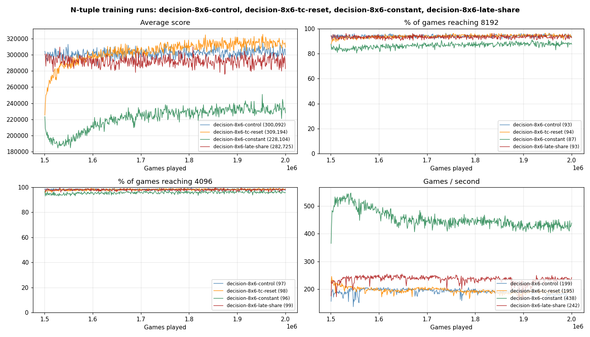

- **Temporal coherence has stalled by 1.5M games, and resetting it breaks the stall.**
  - The control gained nothing measurable in 500k games, against +14.7k from 1M to 1.5M.
  - The reset arm dropped about 25k for the first 50k games, as every weight took full-size steps again, was back level by 150k, and then climbed past the control.
  - It's the best agent yet: 320k greedy, and 402k at 3-ply. That's the first 3-ply result over 400k here, level with Matsuzaki's 407k (a CNN after 240 GPU-hours).
  - It doubled the 32768 rate at depth 3, to 20.1%, which is the weakness the [faster search](#faster-search) results pointed to.
  - Its training average was levelling off by 2M games, about +1k per 50k, so the gain may need repeating. Round 2, below, tests that.
- **Switching a trained network to a constant rate is harmful.**
  - The training average fell to 194k within 50k games and recovered only to about 233k, while the control held 300k.
  - Temporal coherence had shrunk most weights' steps far below 0.0016, and a constant rate never shrinks back.
  - Search hides most of the damage: −12k at depth 3 against −66k greedy, with the same 32768 rate. That suggests the early and middle game suffered most.
  - Guei's schedule uses a constant rate from the start, with optimistic initialisation. A branch can't test that.
- **More late-game experience doesn't help while the rates are settled.** The late-share arm stayed about 10k behind the control in training, ended within noise greedy and 12k behind at depth 3, with a lower 32768 rate. The bottleneck was the learning rates, not a shortage of late-game games.
- **Two quick checks alongside:**
  - **Snapshot averaging.** Averaging the long run's 1M and 1.5M weights gave −1.5k ± 10.6k greedy and +6.5k ± 8.3k at depth 3. That's within noise, and close to 2048-rl's +7k at depth 2.
  - **Temporal coherence's cost.** On the 1.5M network, training runs at 1.8–1.9M moves/s with temporal coherence and 3.4M without, a 1.8× cost, as in 2048-rl. Storing each weight next to its two sums, as 2048-rl does, would cut the memory accesses per update from three to one.

### Round 2: do resets keep paying?

Branching from the TC-reset arm at 2M games, for another 500k each (`ROUND=2 scripts/run_decision_arms.sh`):
- **Continue:** no reset, so the first reset's cycle carries on.
- **Reset again:** a second full reset.
- **Gentle reset:** the sums scaled by 0.1 (`--coherence-scale 0.1`).
  - A weight's rate is the ratio of its two sums, so scaling both keeps every rate as it was. New errors then count ten times as much, so rates rise again wherever errors start agreeing.
  - It's meant to keep a reset's gain without the dip. Halving the sums would barely change anything after 500k games of history.

| Arm | Greedy at 2.5M | vs continue | Exact depth 3 at 2.5M | vs continue | ≥32768 at depth 3 |
|---|---:|---:|---:|---:|---:|
| Continue | 314,202 | — | 397,229 | — | 18.1% |
| Reset again | 317,291 | +3,089 ± 10,879 | 384,451 | **−12,779 ± 9,286** | 14.5% |
| Gentle reset | 315,449 | +1,247 ± 10,819 | 399,341 | +2,112 ± 9,401 | 19.6% |

At 2.25M games the greedy differences were −15,974 ± 10,649 (reset again) and −7,241 ± 10,939 (gentle). Against the 2M network all three started from, continue scored −5,840 ± 11,022 greedy and −4,979 ± 9,348 at depth 3.

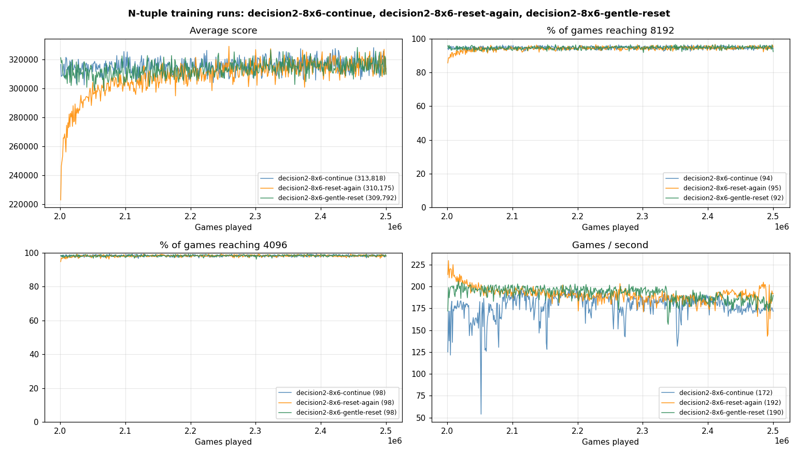

- **The first reset's gain is spent by 2M games.** Continuing for 500k games changed nothing measurable, and its training average stayed at about 315k throughout.
- **A second full reset doesn't repeat the first.**
  - It dipped further (33k against 25k) and recovered more slowly, about 350k games against 150k.
  - It ended level greedy and significantly worse at depth 3, with a lower 32768 rate.
  - A likely reason: a reset helps the weights temporal coherence had frozen, and the late-game weights are both the ones it helps most and the slowest to re-settle, since they're updated rarely. The first reset freed late-game weights frozen since early training. The second hit weights that had only just been re-learned, so it mostly added noise.
- **A gentle reset avoids the dip but gains nothing.** It stayed within about 5k of continue in training and ended level on both measures.
- **So resetting learning rates is a one-off fix, not a schedule.** It released one stall, but at about 315k it no longer restarts progress, while Guei's and 2048-rl's single 8×6 networks reach about 360–370k greedy. The next limit isn't the rates.

### Round 3: optimism for never-updated weights

Guei's and 2048-rl's single 8×6 networks reach about 360–370k greedy, against about 315k here, and both use optimistic initialisation: every weight starts high, so greedy play is drawn to positions it hasn't learned yet. 65% of this network's weights had never been updated by 2M games, which looked like a lack of exploration. Round 3 sets every never-updated weight (still exactly 0) to an optimistic value, from round 1's TC reset at 2M games, for another 500k games (`ROUND=3 scripts/run_decision_arms.sh`, `--optimistic-unvisited VALUE`):
- **1,000 per weight.**
- **5,000 per weight:** 2048-rl's 320,000 per board, spread over 64 weights.

The control is round 2's continue, which started from the same network and changed nothing.

| Arm | Greedy at 2.5M | vs continue | Exact depth 3 at 2.5M | vs continue | ≥32768 at depth 3 |
|---|---:|---:|---:|---:|---:|
| Continue | 314,202 | — | 397,229 | — | 18.1% |
| Optimism at 1,000 | 310,682 | −3,519 ± 10,738 | 396,528 | −701 ± 9,713 | 18.6% |
| Optimism at 5,000 | 317,967 | +3,766 ± 10,824 | 389,712 | −7,518 ± 9,360 | 16.6% |

At 2.25M games the greedy differences were −4,339 ± 10,900 (1,000) and −9,940 ± 10,943 (5,000).

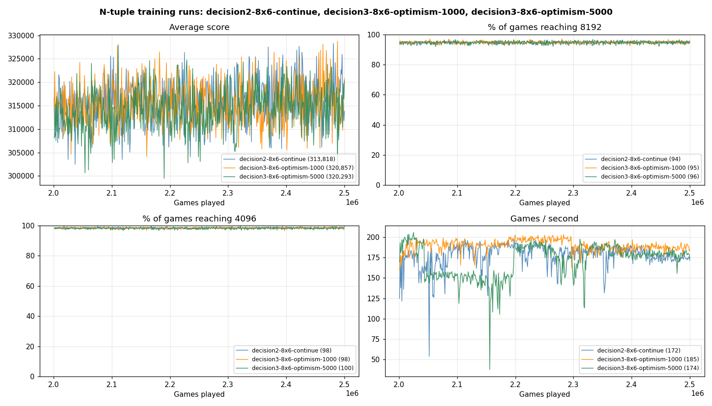

- **Optimism changed nothing.** Both arms tracked continue within a few thousand points in training and ended within noise on both measures.
- **Most never-updated weights can't be reached at all.** Broken down by the largest tile in each weight's pattern:

  | Patterns that include… | Share of all weights | Never updated |
  |---|---:|---:|
  | a 32768 | 32% | 100% |
  | a 16384 or 32768 | 55% | 86% |
  | only tiles up to 8192 | 45% | 40% |

  - With downgrading from 16384, the tuples read every board holding a 16384 with its large tiles halved. So they almost never see a 16384 and never a 32768.
  - About 73% of the never-updated weights are patterns that can't occur, and the rest are mostly rare combinations.
  - So the 65% measured downgrading's footprint, not a lack of exploration, and optimism had little real territory to work on.
- **What this points to instead:** downgrading from 16384 leaves more than half of the 134M weights permanently unused, while one set of shared weights must fit both the 8192 and 16384 stages, whose true values differ.
  - Sharing paid off early, when 16384 was rare (it was most of A + C's +13%).
  - With 75% of games now reaching 16384, it may be the ceiling. The [32768 downgrading test](#next-experiments) checks this by giving the 16384 stage its own weights.

### Downgrading from 32768 instead of 16384

Round 3 found that downgrading from 16384 leaves more than half the network unused, and that one set of weights serves both the 8192 and 16384 stages, whose true values differ. This run tests whether giving the 16384 stage its own weights lifts the ceiling: the long run's setup from scratch, downgrading only boards that hold a 32768 ([`long-8x6-dg32768`](long-8x6-dg32768/NOTES.md), `DOWNGRADE_TILE=32768 EVAL_EVERY=250000 scripts/run_long_run.sh`).

| Games | Greedy | vs the long run (paired) | ≥16384 (long run) | ≥32768 (long run) |
|---:|---:|---:|---:|---:|
| 100k | 153,246 | −14,538 ± 6,587 | 12.9% (20.6%) | 0.0% (0.2%) |
| 250k | 212,947 | −31,129 ± 9,274 | 44.4% (55.3%) | 0.0% (1.9%) |
| 500k | 250,784 | −16,920 ± 9,662 | 62.1% (61.5%) | 0.0% (4.2%) |
| 750k | 255,880 | | 65.8% | 0.0% |
| 1M | 274,755 | −10,476 ± 9,250 | **73.7% (68.0%)** | 0.0% (4.4%) |
| 1.25M | 270,381 | | 71.2% | 0.0% |
| 1.5M | 273,643 | −26,250 ± 9,475 | 70.3% (73.2%) | 0.0% (6.4%) |
| 1.5M, depth 2 | 322,962 | −20,198 ± 7,995 | 87.0% (85.8%) | 0.2% (7.2%) |
| 1.5M, depth 3 | 346,617 | −18,786 ± 6,752 | 93.1% (90.7%) | 0.7% (8.5%) |

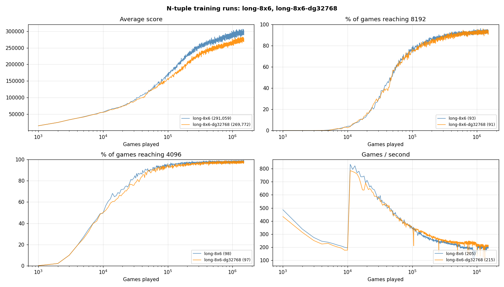

- **Its own weights make the 16384 stage better.** After trailing early without the long run's head start, it reached 16384 in more games from 500k on, 5.7 points more at 1M.
- **But it never learns to make a 32768.** Not one greedy game in any evaluation, and none in training, where the long run already reached 32768 in 4% of games by 500k. It plateaus at about 270–275k from 1M games.
- **Why:** making a 32768 means building a second 16384 next to the first.
  - Downgrading from 16384 reads that board like building a second 8192 next to a 16384, which the network has practised millions of times.
  - With the 16384 stage separate, the step starts from nothing. In a crowded late game, nothing doesn't get far enough to learn.
- **Moving the threshold on a trained network doesn't work either.**
  - `scripts/split_downgrade.py` moves the long run's 1.5M network to downgrading from 32768, and gives each untrained 16384 pattern the weight of the same pattern halved above its own gap.
  - Played greedily, it scored 258,967, −40,927 ± 4,581 against the original. It reached 16384 just as often (73.2%) but 32768 never.
  - Downgrading depends on the whole board: when any cell holds a 16384, every pattern reads its big tiles halved, including those that don't contain the 16384. No per-pattern copy can reproduce that.
  - It wasn't trained further (round 4 in the arms script is left unused).
- **So the threshold is the wrong lever.** Inside one network, it's the only signal that a board is in the 16384 stage, so it can't separate the stages without losing what sharing provides.
  - A second stage chosen by the whole board, starting as an exact copy and still reading boards downgraded from 16384, can separate them without that loss.
  - [Round 5](#next-experiments) tests that.

### Round 5: a second stage

A second stage gives boards with a 16384 or more their own copy of the weights, so the late game can learn values of its own instead of sharing the 8192 stage's. Unlike moving the downgrading threshold, it keeps reading boards downgraded from 16384, so the borrowing that makes 32768s possible survives.
- **The start:** `scripts/add_stage.py` copies the long run's 1.5M network into both stages, and the copy plays all 1,000 evaluation games identically to the original.
- **The test:** trained with reset sums to 2M games (`ROUND=5 scripts/run_decision_arms.sh`), against round 1's TC reset, which made the same reset from the same network with one stage ([`decision5-8x6-two-stage`](decision5-8x6-two-stage/NOTES.md)).

| Arm | Greedy at 1.75M | Greedy at 2M | vs TC reset at 2M | Exact depth 3 at 2M | vs TC reset | ≥16384 at depth 3 | ≥32768 at depth 3 |
|---|---:|---:|---:|---:|---:|---:|---:|
| TC reset (one stage) | 311,045 | 320,042 | — | 402,208 | — | 94.6% | 20.1% |
| Two stages | 247,666 | 257,579 | −62,463 ± 10,573 | 327,421 | −74,787 ± 9,116 | 75.5% | 5.1% |

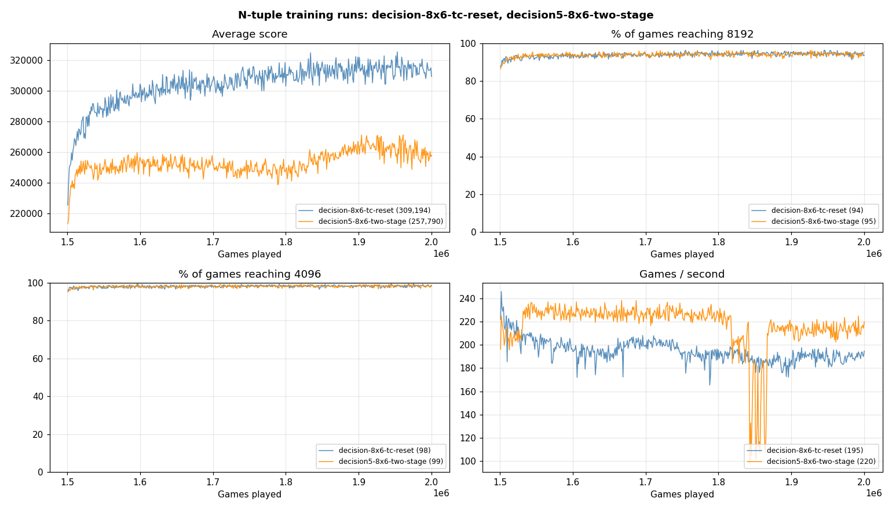

- **It got much worse, and the reason is visible in the 16384 rate.**
  - Greedy, it fell from 73% at the split to 52% by 2M games, while the reset arm held 75–77%.
  - Stage 2 only plays once a 16384 exists, so a falling 16384 rate means stage 1 had become *less willing to make one*.
- **The cause is a flaw in how the stage was chosen.**
  - Each afterstate was read in the stage of its own largest tile. On a board whose largest tile is 8192, the move that merges two 8192s makes a 16384, so it was valued by stage 2 while the board's other moves were valued by stage 1.
  - The stages start identical, but once they learn apart, especially at full rate after the reset, the move into the next stage is judged on a different scale from its alternatives.
  - 2048-rl's player switches networks only once the board holds a 16384, which avoids this.
- **The fix:** choose the stage by the board a move is made from, so every move of a decision is valued, and learned, in one stage (`feat/stage-by-state`, round 8 in the arms script).

### Round 6: temporal coherence with forgetting

Temporal coherence sums each weight's errors over its whole history, so once they've cancelled out over millions of updates its rate stays near zero for good, even if it later has something new to learn. A reset undoes that once (round 1) but doesn't repeat (round 2). Forgetting is the continuous version: each update first shrinks the weight's two sums by a factor just below 1 (`NTUPLE_TC_DECAY`), so its rate follows its recent errors instead of all of them.
- **The arms:** decays of 0.999 (memory of about 1,000 updates) and 0.9999 (about 10,000), from round 1's TC reset at 2M games, for another 500k games (`ROUND=6 scripts/run_decision_arms.sh`).
- **The control:** round 2's continue, the same start without forgetting.

| Arm | Greedy at 2.5M | vs continue | Exact depth 3 at 2.5M | vs continue | ≥16384 at depth 3 | ≥32768 at depth 3 |
|---|---:|---:|---:|---:|---:|---:|
| Continue | 314,202 | — | 397,229 | — | 93.5% | 18.1% |
| Forgetting at 0.999 | 238,499 | −75,702 ± 10,294 | 356,838 | −40,392 ± 9,456 | 87.2% | 11.6% |
| Forgetting at 0.9999 | 274,051 | −40,151 ± 10,704 | 380,698 | −16,531 ± 9,583 | 92.1% | 14.0% |

At 2.25M games the greedy differences were −80,571 ± 10,417 (0.999) and −50,058 ± 11,055 (0.9999).

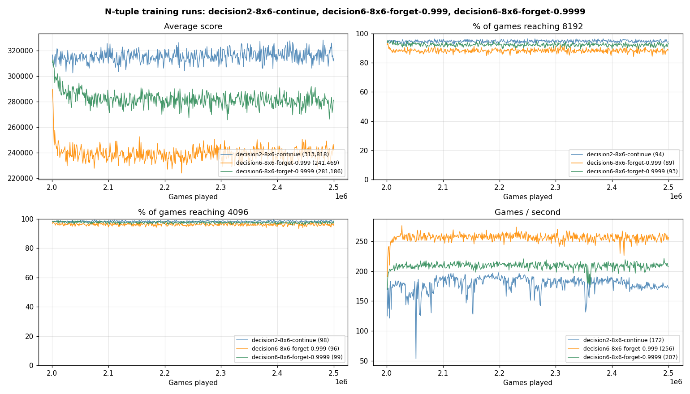

- **Forgetting hurts, and faster forgetting hurts more.** Both arms dropped within the first 50k games and then stayed flat, the 0.999 arm about 75k below continue in training and the 0.9999 arm about 35k.
- **Why:** after millions of updates, a well-trained weight's errors are mostly noise, so its rate had shrunk to nearly nothing. Measured over its last N errors instead, noise looks like a rate of about 1/√N: about 3% of the base rate at 0.999 and 1% at 0.9999, far more than it had. Every settled weight starts taking noisy steps, like the constant-rate arm in round 1, and unlike a reset the rates never settle back.
- **So the rate a trained network needs is lower than any short memory gives.** A slower decay (0.99999 or beyond) would come closer to plain temporal coherence, but there's no sign here of a gain to find on the way. Forgetting is dropped.

### Rounds 8 and 9: a second stage, chosen by the board a move is made from

Round 5's second stage valued each afterstate in the stage of its own largest tile, so the move that made the first 16384 was judged by stage 2 against stage 1's values for the board's other moves, and the agent learned to avoid making it. Here every move of a decision is valued, and learned, in the stage of the board it's made from, as 2048-rl's player switches networks only once the board holds a 16384.
- **Round 8:** the same start and reset as round 5, the long run's 1.5M network given a second stage, trained to 2M games against round 1's TC reset (`ROUND=8 scripts/run_decision_arms.sh`).
- **Round 9:** round 8 carried on to 2.5M, against round 2's continue, the reset arm carried on over the same games (`ROUND=9`).

| Arm | Games | Greedy | vs one stage | Exact depth 3 | vs one stage | ≥16384 at depth 3 | ≥32768 at depth 3 |
|---|---:|---:|---:|---:|---:|---:|---:|
| One stage (TC reset) | 2M | 320,042 | — | 402,208 | — | 94.6% | 20.1% |
| Round 5's two stages | 2M | 257,579 | −62,463 ± 10,573 | 327,421 | −74,787 ± 9,116 | 75.5% | 5.1% |
| [Round 8](decision8-8x6-two-stage-by-state/NOTES.md)'s two stages | 2M | 287,985 | −32,057 ± 10,423 | 367,599 | −34,609 ± 8,644 | 93.1% | 8.2% |
| One stage (continue) | 2.5M | 314,202 | — | 397,229 | — | 93.5% | 18.1% |
| [Round 9](decision9-8x6-two-stage-by-state/NOTES.md)'s two stages | 2.5M | 302,656 | −11,546 ± 10,755 | 374,308 | −22,921 ± 8,699 | 93.0% | 9.7% |

At 1.75M games round 8 was −59,191 ± 9,927 greedy against the reset arm, and at 2.25M round 9 was −27,483 ± 10,902 against continue.

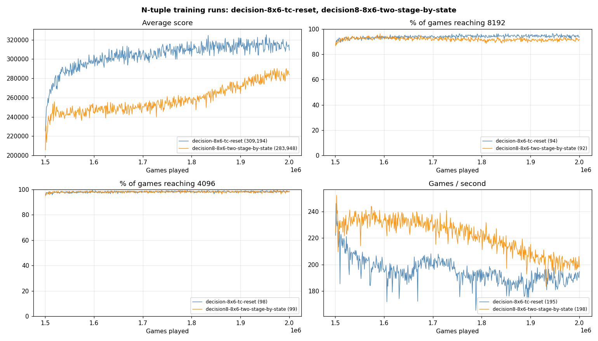
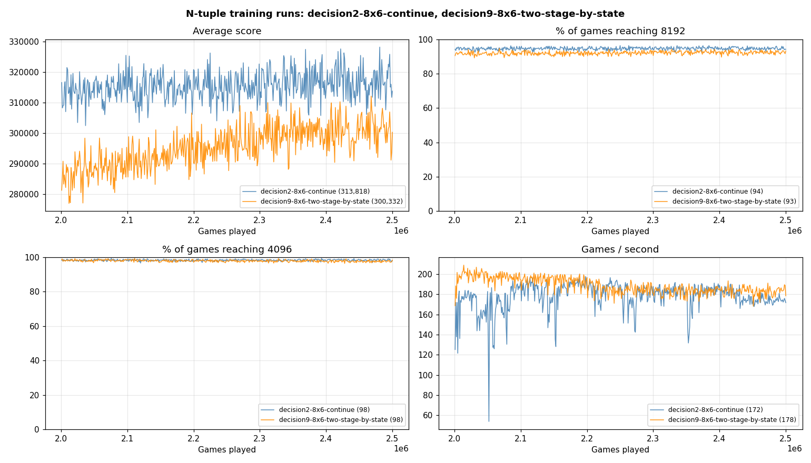

- **The fix works where it should.**
  - The 16384 rate no longer falls: it recovered from 58% at 1.55M to 72% by 2.5M in training, and to 93% at depth 3, level with one stage.
  - Against round 5, the fix gained 30k greedy and 40k at depth 3.
- **Two stages are still behind one after 1M games.**
  - Greedy, the gap closed from −59k at 1.75M to −11.5k at 2.5M, now near the edge of noise. The training average levelled off at about 300k by 2.4M, while one stage held about 315k.
  - At depth 3 it's still 23k behind, and it makes a 32768 in half as many games (9.7% against 18.1%).
- **The likely cost is the reset, doubled.**
  - Both stages restarted at full rate, and each weight now gets only the updates for its own stage, so the noisy phase lasts longer. The late-game stage, which is updated least, is noisiest of all.
  - That fits a slow recovery that hits the 32768 step hardest.
- **So a second stage hasn't paid for itself within 1M games of a full reset.**
  - The fair next test splits without resetting: the long run's 1.5M network given a second stage with its sums kept (`scripts/add_stage.py --keep-coherence`), against round 1's control.
  - 2048-rl's second stage needed tens of millions of games, so a split may also need far more training than a branch test gives.

### Round 10: a second stage without the reset

Rounds 5, 8 and 9 all reset the temporal coherence sums at the split, so the reset's shock could explain their deficit. Here the long run's 1.5M network gets a second stage with its sums kept (`scripts/add_stage.py --keep-coherence`), stage chosen by the board a move is made from, trained to 2M games against round 1's control: the same start, one stage, no reset (`ROUND=10 scripts/run_decision_arms.sh`, [`decision10-8x6-two-stage-kept-sums`](decision10-8x6-two-stage-kept-sums/NOTES.md)).

| Arm | Greedy at 1.75M | Greedy at 2M | vs control at 2M | Exact depth 3 at 2M | vs control | ≥16384 at depth 3 | ≥32768 at depth 3 |
|---|---:|---:|---:|---:|---:|---:|---:|
| Control (one stage) | 300,341 | 302,227 | — | 368,795 | — | 90.9% | 9.6% |
| Two stages, sums kept | 282,349 | 286,492 | −15,735 ± 10,098 | 350,274 | −18,521 ± 8,044 | 91.8% | 6.8% |

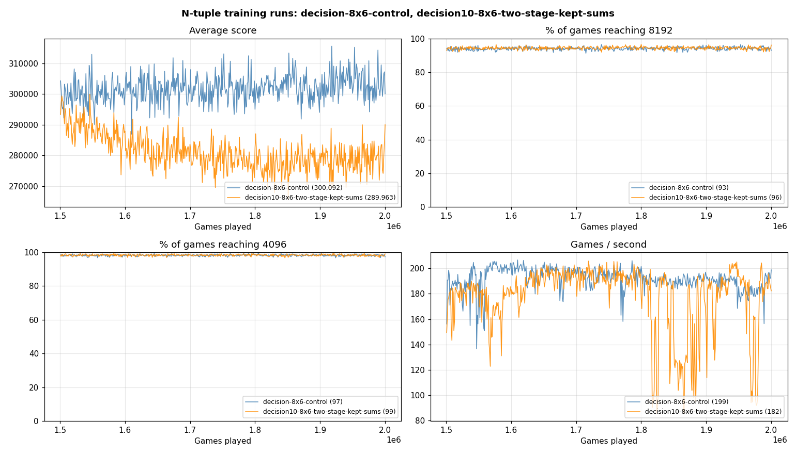

- **A second stage loses even without the reset.**
  - It started level (the copy plays identically).
  - It drifted down for the first 200k games, its training average falling from about 291k to 279k while the control held about 301k, then stayed about 20k behind.
  - It ends significantly worse both greedy and at depth 3, with a lower 32768 rate.
- **The likely reason is specific to downgrading during training: sharing works in both directions.**
  - With one table, every update from a 16384-stage board also trains the weights the 8192 stage reads, since the downgraded board looks like an 8192 board. In long games that's a large share of all moves.
  - Splitting cuts that link, so stage 1 learns only from boards below 16384, and its play towards the first 16384 slowly loses what the late game had been teaching it.
  - Guei's, Yeh's and 2048-rl's stages don't share across scales in training, so splitting costs them nothing.
- **So with downgrading in training, a second stage needs far more training than these tests give, or a design that keeps feeding late-game experience back into stage 1.** It's left out of the final run for now.

### Round 11: a learning-rate cut

The base rate of 0.02 was chosen on a 200k-game screen for early speed. That's 1.28 per board, above what Jaśkowski calls the maximum sensible step of 1.0, and far above the rates Guei and Yeh used. Both found that cutting the rate of a plateaued network gave a step up. Here the reset network at 2M games carries on at 0.005 with its sums kept, against round 2's continue at 0.02 (`ROUND=11 scripts/run_decision_arms.sh`, [`decision11-8x6-rate-0.005`](decision11-8x6-rate-0.005/NOTES.md)).

| Arm | Greedy at 2.25M | Greedy at 2.5M | vs continue | Exact depth 3 at 2.5M | vs continue | ≥32768 at depth 3 |
|---|---:|---:|---:|---:|---:|---:|
| Continue (0.02) | 318,858 | 314,202 | — | 397,229 | — | 18.1% |
| Rate cut (0.005) | 319,704 | **325,195** | +10,993 ± 11,126 | 397,459 | +229 ± 9,088 | 17.2% |

At 2.25M the greedy difference was +846 ± 10,718. In training the cut led continue by +4k to +7k in every 50k-game window, levelling off at about 322k from 2.3M games.

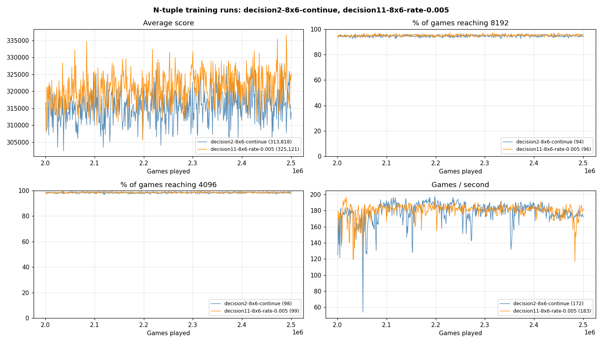

- **The cut gives a small, steady greedy gain and nothing with search.**
  - Greedy, 325k is the best of any network so far, though the paired gain only just misses significance.
  - At depth 3 and in the 32768 rate it's level with continue.
- **So the lower rate removes noise from the weights, but doesn't teach the network anything new about the late game.** It isn't the large hidden gain Guei found in fixed-rate networks: those weren't settled, while ours already were, by temporal coherence.
- **For the final run,** a lower rate in the last stretch is a cheap polish for greedy play. It won't lift the plateau.

### Round 12: a reset for the two-stage network

Round 10's two-stage network, at about 280k when it stopped, never had the temporal coherence reset that gave one stage its jump. Here it gets one at 2M games, against round 2's continue (`ROUND=12`, [`decision12-8x6-two-stage-reset`](decision12-8x6-two-stage-reset/NOTES.md)).

| Arm | Greedy at 2.25M | Greedy at 2.5M | vs continue | Exact depth 3 at 2.5M | vs continue | ≥16384 at depth 3 | ≥32768 at depth 3 |
|---|---:|---:|---:|---:|---:|---:|---:|
| Continue (one stage) | 318,858 | 314,202 | — | 397,229 | — | 93.5% | 18.1% |
| Two stages + reset | 251,531 | 296,640 | −17,561 ± 10,917 | 375,427 | −21,803 ± 8,899 | 92.2% | 12.1% |

At 2.25M the greedy difference was −67,326 ± 10,272.

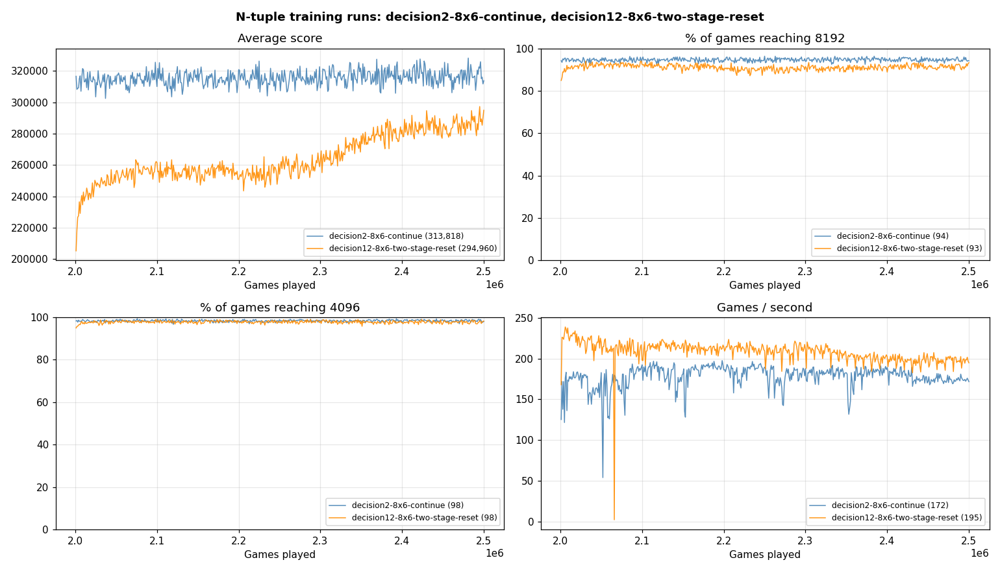

- **The reset gave no jump.** The training average fell to about 244k, stuck at about 255k for 200k games, then climbed to about 286k by 2.5M, little above the 279k it started from.
- **So two stages are behind one in every version tried:** reset at the split (round 9), no reset (round 10), and reset later (round 12).
  - That fits the explanation in round 10: with downgrading in training, a second stage cuts the late game's experience off from the 8192 stage's weights.
  - A second stage stays out of the final run.

### Round 12B: round 12 carried on to find its plateau

Round 12's training average was still climbing at 2.5M (about +2k to +5k per 50k games), so its network was trained a further 250k games with nothing changed and no further reset (`ROUND=12B`, [`decision12b-8x6-two-stage-continued`](decision12b-8x6-two-stage-continued/NOTES.md)). Each evaluation is compared with round 12's at 2.5M.

| Network | Greedy | vs round 12 | Exact depth 3 | vs round 12 | ≥16384 at depth 3 | ≥32768 at depth 3 |
|---|---:|---:|---:|---:|---:|---:|
| Round 12 at 2.5M | 296,640 | — | 375,427 | — | 92.2% | 12.1% |
| Round 12B at 2.625M | 296,292 | — | | | | |
| Round 12B at 2.75M | 293,255 | −3,385 ± 11,129 | 383,826 | +8,399 ± 8,508 | 94.3% | 12.4% |

The runner's summary pairs the 2.625M snapshot with round 12's halfway point (2.25M), so it shows a misleading +44,760 there.

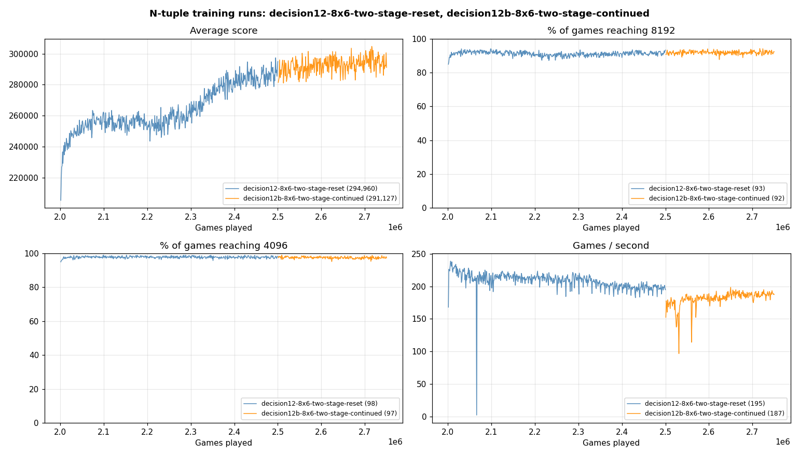

- **The two-stage network has plateaued.** The training average crept from about 286k to 295k, but greedy play didn't move, and depth 3 gained only a borderline 8k.
- **It levelled off about 20k below one stage at 2.5M** (314,202 greedy, 397,229 at depth 3), with half as many 32768s at depth 3, after 250k more games. This closes the two-stage line.

### Round 13: redundant small tuples

Jaśkowski's redundant encoding adds small tuples alongside the large ones: they repeat what the 6-tuples already see, but at a coarser grain, so each weight is shared by many more boards. He reported about +52k greedy from it. Here the seven tuples (two rows and three squares as 4-tuples, and two 3-tuples) are added at zero to the TC-reset network at 2M games, then trained on 500k games against round 2's continue (`ROUND=13`, [`decision13-8x6-redundant`](decision13-8x6-redundant/NOTES.md)). The base rate drops to 0.0107, so a board's total step over its 120 lookups matches the 8x6 network's 64 at 0.02.

| Arm | Greedy at 2.25M | Greedy at 2.5M | vs continue | Exact depth 3 at 2.5M | vs continue | ≥16384 at depth 3 | ≥32768 at depth 3 |
|---|---:|---:|---:|---:|---:|---:|---:|
| Continue | 318,858 | 314,202 | — | 397,229 | — | 93.5% | 18.1% |
| Redundant tuples | 317,362 | 300,308 | −13,893 ± 11,099 | 390,113 | −7,116 ± 9,619 | 92.2% | 17.7% |

At 2.25M the greedy difference was −1,496 ± 11,032.

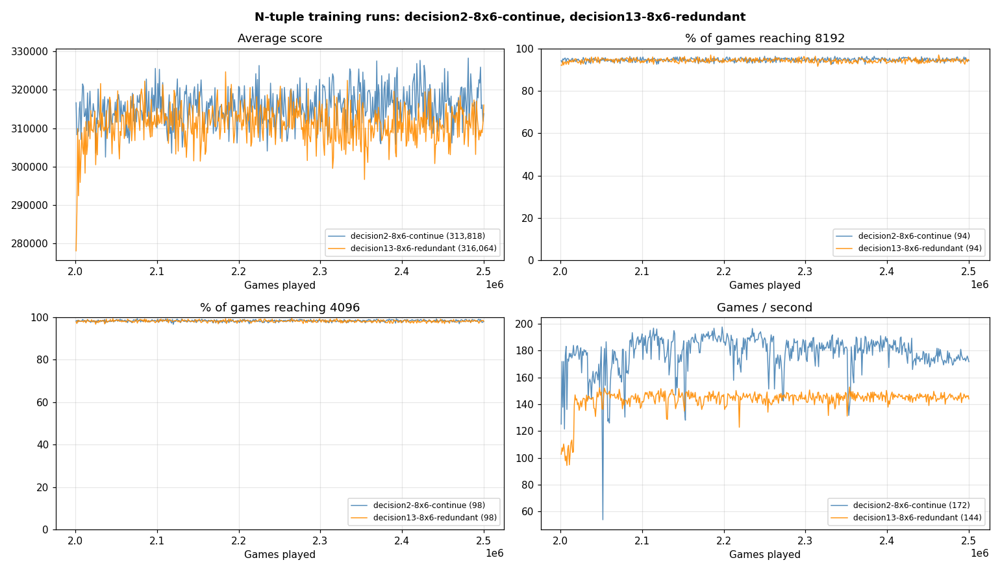

- **Added to a trained network, redundant tuples don't help.** The training average dipped to about 308k, recovered to about 312k by 2.1M, then stayed 3k to 7k behind continue. Greedy at 2.5M is significantly worse, and depth 3 is level within noise.
- **The new tuples start at zero and at the full rate,** while the 6-tuples' rates have mostly shrunk. So the new tuples absorb the error the 6-tuples were still correcting, and they add nothing the 6-tuples didn't already see.
- **The published gain likely comes from faster early learning,** when coarse features carry play while the 6-tuples are still sparse. The fair test is training from scratch, a long run better suited to the Ryzen. Training is also about 20% slower in games per second.

### Redundant tuples from scratch

The same network trained from zero with the long run's recipe, against the long run game for game (`RUN=long-8x6-redundant NETWORK=8x6-redundant LEARNING_RATE=0.0107 scripts/run_long_run.sh`, [`long-8x6-redundant`](long-8x6-redundant/NOTES.md)). It was stopped at 264k games, when it had stopped reaching 16384.

| Games | Training average, redundant | Training average, long run | Greedy, redundant | Greedy, long run | Paired difference | ≥16384 greedy, redundant / long run |
|---:|---:|---:|---:|---:|---:|---:|
| 50k | 102,958 | 81,073 | | | | |
| 100k | 146,311 | 145,753 | 150,471 | 167,785 | −17,314 ± 5,583 | 1.2% / 20.6% |
| 150k | 148,505 | 187,105 | | | | |
| 200k | 145,333 | 216,265 | | | | |
| 250k | 140,451 | 235,124 | 137,947 | 244,076 | −106,130 ± 7,334 | 0.0% / 55.3% |

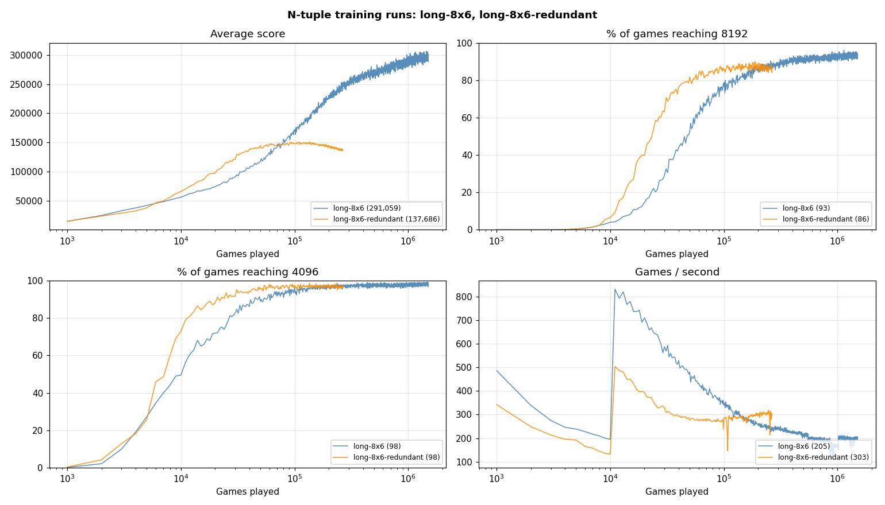

- **It learned the early game faster, then hit a wall at 16384.** It led by 22k over the first 50k games and reached 8192 more often (86% against 68% of training games from 50k to 100k), but its 16384 rate never rose above 1%, and its average slowly fell from 148k.
- **The small tuples took over the board's value.** At 250k games, its 6-tuple weights averaged 16.9 in size, against 43.1 in the long run, while its 3-tuple weights averaged about 2,900. Played with only its 6-tuples, the network averaged 3,818 and never reached 4096.
  - The small tuples are read on nearly every move, so they absorbed the error first and left the 6-tuples little to learn.
  - 3- and 4-cell patterns can't represent the large-tile arrangements needed to build a second 8192, and the 6-tuples that could never learned them.
- **So redundant encoding is shelved.** It loses whether added to a trained network or trained from scratch. Jaśkowski's gain came under a different schedule and without downgrading. A rescue (dropping the 3-tuples, or a lower rate for the small tuples) would need another long run for a technique worth about +52k under his conditions.

## Late-game diagnostics

The decision arms leave a clear pattern: the network learns everything up to 16384 efficiently, then converts a first 16384 into a 32768 in only about 21% of depth-3 games (20.1% against 94.6% reaching 16384, for round 1's TC reset at 2M). The next stages diagnose why before spending more training: whether the late game's positions aren't seen, are learned wrongly, or can't be told apart. Each stage is built on its own branch, and each result that depends on training needs two more seeds before it's relied on.

### Stage 0: protocol checks

No training. The pieces later stages measure with:
- **Manifests:** each training session now records the SHA-256 of the checkpoint it resumed from and its CPU time. Evaluations already recorded their checkpoint's hash and seeds.
- **`scripts/compare_runs.py`:** compares runs' evaluations with a reference game for game, with paired bootstrap 95% intervals for the average, the 16384 and 32768 rates, and the 16384→32768 conversion.
- **`scripts/update_gain.py`:** how far one temporal coherence update really moves a board's value, by stage of the game.
- **`scripts/check_search_cache.py`:** what the search's transposition table changes when unlikely spawns are pruned.
- **Tests** of the 32768 limit: 16384s merge into it, 32768s don't merge (seeded games end there), and downgrading halves it.

**The effective gain of an update.** A board reads 64 weights, and an update with error δ moves its value by δ × lr × Σ cᵢmᵢ², over its distinct weights i read mᵢ times, with coherence cᵢ. With every weight at full rate and no repeats, that's 1.28 at lr 0.02. Measured on the afterstates of 20 greedy games per network:

| Network | 1024 | 4096 | 8192 | 16384 (downgraded) | 32768 |
|---|---:|---:|---:|---:|---:|
| Long run, 500k games | 0.016 (54%) | 0.014 (61%) | 0.012 (68%) | 0.011 (69%) | |
| Long run, 1.5M (stalled) | 0.009 (80%) | 0.007 (84%) | 0.006 (87%) | 0.006 (86%) | |
| TC reset, 2M (the best network) | 0.006 (88%) | 0.005 (90%) | 0.005 (91%) | 0.005 (91%) | 0.012 (73%) |

Each cell is the median gain ΔV/δ for boards with that largest tile, with the share of the weights they read whose coherence is below 1% in brackets. No 32768 boards came up in the long run's greedy games.

- **Temporal coherence has frozen the whole network, not just the late game.** By 1.5M games a board's value moves by about 0.5% of the nominal step, at every stage alike. The 32768 boards are the least frozen, but only slightly.
- **The reset's restored rates are used up within 500k games.** Its 2M network is as frozen as the stalled 1.5M one was.
- **Repeats don't matter.** Repeated weights only add to the gain on near-empty opening boards; from 32 up, the repeat factor is 1.00 to 1.04.
- **So the late game isn't learning at a lower rate than the rest; it gets fewer updates.** A weight's coherence falls as roughly one over the square root of its updates once its errors are noise, so the rarely seen late-game weights have the most to gain from a rate that keeps adapting. Stage 1 checks whether their values are actually wrong.

**The search cache.** On 200 positions from the 2M network's greedy games, half with an 8192 or larger:

| Depth | Cutoff | Chosen move changes | Largest change in the chosen move's value | ms per position, with the table | without |
|---:|---:|---:|---:|---:|---:|
| 3 | 0 | 0 | 0 (exact, as a test checks) | 0.4 | 0.5 |
| 4 | 0.05 | 0 | 3.4×10⁻⁴ of its value | 0.6 | 1.0 |
| 5 | 0.1 | 0 | 0 | 0.3 | 0.4 |
| 6 | 0.1 | 0 | 0 | 0.4 | 0.4 |

The table's approximation under pruning is negligible: it never changed a move.

### Stage 1: where the late game goes wrong

No training. Everything uses round 1's TC-reset network at 2M games.

- **The corpus** ([`late-game-corpus`](late-game-corpus/)): `scripts/late_game_corpus.py` played 666 greedy games and 547 depth-3 games until each policy had 500 that made a 16384, recording each game's first-8192 and first-16384 boards and every 50th board.
  - Seeds start at 1,000,000 (greedy) and 2,000,000 (depth 3), clear of the 0–999 evaluation seeds.
  - Positions are split into train, dev and test sets by source game (60/20/20). Later training may use only the train set.
- **The tests** (`scripts/late_game_tests.py`, results in [`late-game-diagnostics`](late-game-diagnostics/)):
  - **coverage:** how often training updates the weights positions read, counted over 2,500 games played as training plays them. The counts are split by whether the board moved from holds a 16384.
  - **conversion:** 8 greedy and 8 depth-3 continuations from every first-16384 position, sharing spawns.
  - **actions:** 240 late positions (largest tile 16384 or more; half at random, half where greedy play's top two moves are closest). Every legal move is followed by 64 greedy and 8 depth-3 rollouts, with spawns shared across moves.

**Coverage: the 16384 stage isn't short of experience.**

| Positions | Weights not updated in 2,500 games | Updated ≥100 times per 1k games | Their updates from boards below 16384 |
|---|---:|---:|---:|
| First 8192 (greedy / depth-3 games) | 1.1% / 1.5% | 78% / 75% | 59% / 58% |
| First 16384 (greedy / depth-3 games) | 1.1% / 1.1% | 78% / 77% | 59% / 59% |
| Largest tile 4096 | 11% | 72% | 65% |
| Largest tile 16384 | 11% | 71% | 42–43% |
| Largest tile 32768 | 15–16% | 55–57% | 37% |
| 16384, 0–250 moves after the first (went on to a 32768 / didn't) | 6.5% / 6.6% | 71% / 72% | 55% / 55% |
| 16384, 2,000+ moves after the first (went on to a 32768 / didn't) | 10.2% / 10.7% | 71% / 70% | 37% / 38% |

The shares are of the weights read by every legal move from a position.

- **16384-stage positions read weights as well trained as the early game's.** Coverage doesn't thin as the stage goes on, and it's the same in games that go on to a 32768 as in games that don't. Only the 32768 stage reads noticeably rarer weights.
- **Greedy and depth-3 play reach equivalent positions.** Their coverage matches, they reach a first 16384 after the same score (210k) and number of moves (7,466), and those positions convert equally well (below).
- **Downgrading makes the 16384 stage reuse the 8192 stage's weights.** A first-16384 board (a 16384 plus small tiles) reads exactly the weights a first-8192 board does. Training's late starts are doubled first-8192 boards, which downgrading halves straight back.

**Conversion and values: the network can't tell a first 16384 from a first 8192.**

| From first-16384 positions of | Continued by | Makes 32768 | Score added |
|---|---|---:|---:|
| Greedy games | Greedy | 10.8% | 161,673 ± 2,505 |
| Greedy games | Depth 3 | 18.3% | 201,273 ± 2,777 |
| Depth-3 games | Greedy | 11.3% | 162,193 ± 2,452 |
| Depth-3 games | Depth 3 | 19.3% | 202,388 ± 2,644 |

| Position | Network's estimate of the score to come | Actually scored afterwards, greedy | Estimate ÷ actual |
|---|---:|---:|---:|
| First 8192 | 237,458 | 228,236 ± 8,288 | 1.04 |
| First 16384 | 237,275 | 156,567 ± 6,591 | 1.52 |

- **The source policy doesn't matter;** from the same positions and spawns, depth-3 search adds 40k ± 3.5k and converts 18–19% against greedy play's 11%.
- **The network values a first 16384 like a first 8192:** accurate at the first 8192, 50% too high at the first 16384, with nearly the same estimate. Every first-16384 board is changed by downgrading.
- **Through the 16384 and 32768 stages, afterstate values are 77k to 94k too high** against greedy play's returns from them. Each legal move's afterstate in the action test is compared with the average of its 64 greedy rollouts:

| Largest tile | Empty cells | Afterstates | Mean predicted | Mean greedy return | Bias | Mean absolute error | Network's top move is the rollouts' top move |
|---:|---|---:|---:|---:|---:|---:|---:|
| 16,384 | 0–3 | 526 | 166,402 | 89,052 | +77,351 | 82,051 | 46% |
| 16,384 | 4–7 | 304 | 180,096 | 101,631 | +78,464 | 83,005 | 44% |
| 32,768 | 0–3 | 32 | 146,946 | 52,686 | +94,260 | 94,842 | 67% |
| 32,768 | 4–7 | 18 | 162,055 | 73,560 | +88,495 | 88,495 | 60% |

  The last column is only a rough guide: the rollouts' top move is itself noisy when moves are close, which they mostly are (see action ranking below).
- **The shared weights are pulled both ways.** Among the 1.2M weights with at least 20 counted updates, grouped by the share of their updates that came from boards below 16384, the net direction of their accumulated errors (Σ error / Σ |error|, negative meaning their values are pushed down):

| Updates from boards below 16384 | Weights | Net error direction | Median coherence | Median counted updates |
|---|---:|---:|---:|---:|
| None (16384 stage only) | 138,596 | −0.035 | 0.045 | 39 |
| Under 10% | 21,128 | −0.008 | 0.024 | 33 |
| 10–40% | 359,674 | +0.002 | 0.015 | 86 |
| 40–60% | 327,145 | +0.006 | 0.014 | 156 |
| 60–90% | 236,068 | +0.012 | 0.015 | 157 |
| Over 90% | 77,183 | +0.015 | 0.016 | 269 |
| All (earlier stages only) | 40,366 | +0.026 | 0.038 | 49 |

  The 16384 stage pushes its weights down and the earlier stages push theirs up, with shared weights in between in order of their share. The 8192 stage, which every game passes through, wins. The shared weights' lower coherence fits errors that cancel, but it's confounded with their larger number of updates.

**Action ranking: no measurable single-move mistakes.** Each decider's choice is judged against every legal move's average score to come under each continuation. "Clearly worse" means some move beats it by more than 2 standard errors of their paired difference. "Score lost" picks the best move on half the rollouts and measures its gain over the choice on the other half, both ways round, so it isn't inflated by noise. Negative means the choice did better than the move the data picked.

| Positions from | Group | Decider | Judged by | Positions | Not the best on average | Clearly worse | Score lost |
|---|---|---|---|---:|---:|---:|---:|
| Greedy games | Random | Greedy play | Greedy, 64 rollouts | 60 | 63% | 7% | 1,549 ± 2,904 |
| Greedy games | Random | Greedy play | Depth 3, 8 rollouts | 60 | 62% | 3% | −13,220 ± 8,696 |
| Greedy games | Random | Depth-3 search | Greedy, 64 rollouts | 60 | 60% | 8% | 1,891 ± 2,969 |
| Greedy games | Random | Depth-3 search | Depth 3, 8 rollouts | 60 | 63% | 3% | −12,424 ± 8,480 |
| Greedy games | Close call | Greedy play | Greedy, 64 rollouts | 60 | 60% | 2% | −2,789 ± 2,065 |
| Greedy games | Close call | Greedy play | Depth 3, 8 rollouts | 60 | 80% | 7% | 2,169 ± 9,443 |
| Greedy games | Close call | Depth-3 search | Greedy, 64 rollouts | 60 | 70% | 7% | −1,521 ± 2,548 |
| Greedy games | Close call | Depth-3 search | Depth 3, 8 rollouts | 60 | 73% | 5% | −2,286 ± 9,373 |
| Depth-3 games | Random | Greedy play | Greedy, 64 rollouts | 60 | 37% | 0% | −3,178 ± 1,617 |
| Depth-3 games | Random | Greedy play | Depth 3, 8 rollouts | 60 | 57% | 7% | −2,638 ± 9,083 |
| Depth-3 games | Random | Depth-3 search | Greedy, 64 rollouts | 60 | 40% | 0% | −2,701 ± 1,544 |
| Depth-3 games | Random | Depth-3 search | Depth 3, 8 rollouts | 60 | 57% | 3% | −3,523 ± 8,653 |
| Depth-3 games | Close call | Greedy play | Greedy, 64 rollouts | 60 | 55% | 2% | −2,096 ± 1,950 |
| Depth-3 games | Close call | Greedy play | Depth 3, 8 rollouts | 60 | 72% | 2% | −1,621 ± 8,379 |
| Depth-3 games | Close call | Depth-3 search | Greedy, 64 rollouts | 60 | 50% | 3% | −1,935 ± 2,242 |
| Depth-3 games | Close call | Depth-3 search | Depth 3, 8 rollouts | 60 | 72% | 2% | −1,447 ± 8,269 |

- **Single moves:** the choices were clearly worse than another move in 0–8% of positions. That's about the false-positive rate with up to three alternatives each. The score lost was within noise of zero in every group. "Not the best on average" is high only because most moves are near-ties, so the rollouts' best move is a coin toss.
- **Sharing and familiarity:** each position is scored by the share of its weights' updates that came from boards below 16384 (sharing), and the share of its reads whose weights training updates less than once per 1,000 games (unfamiliar). Split by both, the error rates show no pattern:

| Positions | Count | Mean sharing | Mean unfamiliar | Greedy play, judged by greedy: clearly worse | Score lost | Depth-3 search, judged by depth 3: clearly worse | Score lost |
|---|---:|---:|---:|---:|---:|---:|---:|
| Sharing: lowest third | 80 | 34.5% | 17.3% | 1% | −1,807 ± 1,572 | 2% | −5,966 ± 7,154 |
| Sharing: middle third | 81 | 44.7% | 14.7% | 2% | −730 ± 2,160 | 6% | −5,080 ± 6,909 |
| Sharing: highest third | 79 | 54.4% | 14.1% | 4% | −2,368 ± 1,998 | 1% | −3,697 ± 8,610 |
| Unfamiliar: lowest third | 87 | 45.3% | 8.9% | 0% | −1,807 ± 1,543 | 2% | −3,796 ± 6,876 |
| Unfamiliar: middle third | 75 | 45.9% | 15.0% | 5% | −338 ± 2,382 | 5% | −4,881 ± 8,697 |
| Unfamiliar: highest third | 78 | 42.2% | 22.9% | 3% | −2,670 ± 1,860 | 3% | −6,212 ± 7,253 |
| More shared, more familiar | 67 | 51.8% | 10.7% | 3% | −1,189 ± 2,238 | 3% | −2,447 ± 7,639 |
| More shared, less familiar | 53 | 51.7% | 19.1% | 4% | −2,785 ± 2,529 | 4% | −4,794 ± 11,385 |
| Less shared, more familiar | 60 | 38.1% | 10.2% | 3% | −285 ± 2,386 | 3% | −6,430 ± 8,608 |
| Less shared, less familiar | 60 | 36.4% | 22.4% | 0% | −2,441 ± 1,688 | 3% | −6,285 ± 7,709 |
- **What the test can and can't detect:** it detects single-move losses of a few thousand points. The 40k that search adds over the rest of the game is spread over thousands of moves, a few points each, far below it. **So the overestimate is mostly the same for every move, and decisions go wrong only by small amounts that add up.** Action ranking can't separate aliasing from experience at this resolution, and the conversion test can: about 2.5k precision on 500 positions in 3 minutes greedy.

**Where this differs from the plan.**
- **Corpus:** 500 first-16384 positions from each policy (1,000 in all) rather than 2,000 from depth 3 alone, to see whether the training policy reaches different positions from the evaluation policy.
- **Action quality** is measured by rolling out every legal move, rather than against a depth-4 search's choice. A rollout measures what a choice actually costs, and a search's disagreement doesn't.
- **Greedy and depth-3 continuations are reported separately throughout,** since the network was trained on greedy play's returns.
- **Hard positions** are those where greedy play's top two moves are closest, not also those with few empty cells.
- **Calibration** isn't split by whether downgrading is active, since every 16384-stage board is downgraded, or by structural features.
- **Added:** coverage of the weights positions read, split by progress after the first 16384 and by stage of training, and action-ranking errors split by how shared and how familiar a position's weights are.

**What this points to.** By the plan's decision rule, a large, systematic value error at 16384 points to stage 3: a small residual that reads the real, undowngraded board, gated on at 16384, can learn the correction the shared weights can't hold. Unlike the second stages of rounds 5–12, it keeps the shared base, and with it what the 8192 stage teaches the 16384 stage. Its yardstick should be greedy conversion from the held-out test split's first-16384 positions, with depth 3 and full games after. Each result needs two more training seeds before it's relied on.

### Stage 3: correcting the late-game values

The question: does a position-dependent correction to the late game's values improve play, or only the values? The base, round 1's TC-reset network at 2M games, stays frozen throughout: its weights, its temporal coherence sums and its downgrading.

**The arms** (`deep_2048/agents/ntuple/residual.py`, `scripts/late_residual.py`, results in [`late-residual`](late-residual/)):
- **baseline:** the base, unchanged.
- **late-constant:** a constant added to every afterstate whose real largest tile is 16384 or more.
  - It was fitted on the corpus's train split only: the gap between 8 greedy rollouts' return and the base's value, over 1,000 late afterstates greedy play chose.
  - It came out at **−106,513 ± 2,230**, larger than stage 1's 77–94k. That bias averaged over every legal move, and the move greedy play chooses is the one most likely to be overvalued.
- **residual:** the constant plus four 5-tuples (two rows with the cell below their end, two 2×2 squares with a cell below), read from the real tile exponents in all 8 symmetries.
  - That's 32 reads per board and 4.2M weights, starting at zero.
  - It's trained by TD(0) on the combined value (0 at the end of a game), from the train split's 606 genuine first-16384 positions, at a fixed rate shared over its 32 reads.

**How the correction is applied.**
- **The gate** is decided by the real afterstate being valued, inside the network's value function, so greedy play, training and expectimax all apply it alike.
- **Storage:** corrected checkpoints store only the correction, with the base checkpoint's path and SHA-256, and refuse a base that has changed.
- **Testing:** tests check that a zero correction plays exactly as the base, that the gate and residual read the real board, and that training changes only the residual.

**The yardstick.** The test split's 196 first-16384 positions, which neither fitting nor training saw:
- 32 greedy and 8 depth-3 continuations each, with the same spawns for every arm, so differences are paired by position.
- How often each arm's greedy move differs from the base's, on 26,890 late test-split boards and on 332 boundary boards. Boundary boards were found by replaying the test games: some move makes the game's first 16384, so moves differ in whether their afterstate is past the gate.
- 1,000 full greedy games.

| Arm | Greedy conversion | vs baseline | Score added, greedy | vs baseline | Depth-3 conversion | Score added, depth 3 |
|---|---:|---:|---:|---:|---:|---:|
| Baseline | 10.7% | — | 160,638 | — | 19.5% | 203,057 |
| Constant | 10.7% | ±0 | 160,638 | ±0 | 15.1% (−4.5pp ± 2.4) | 183,015 (−20.0k ± 5.0k) |
| Residual, 0.1 per board, its own games | 0.0% | −10.7pp ± 0.8 | 41,614 | −119.0k ± 2.0k | 0.0% | 43,236 |
| Residual, 0.1 per board, the base's games | 0.0% | −10.7pp ± 0.8 | 56,659 | −104.0k ± 2.1k | | |
| Residual, 0.01 per board, its own games | 0.6% | −10.1pp ± 0.8 | 115,566 | −45.1k ± 2.3k | | |
| Residual, 0.01 per board, the base's games | 0.3% | −10.4pp ± 0.7 | 111,242 | −49.4k ± 2.2k | | |

| Arm | Estimate of the score to come at a first 16384 ÷ its own greedy play's | Late moves changed | Boundary moves changed | Makes the 16384 at the boundary | Full greedy games (1,000) |
|---|---:|---:|---:|---:|---:|
| Baseline | 1.48 | — | — | 61% | 320,042 (32768 in 8.5%) |
| Constant | 0.82 | 0% | 61% | 0% | 322,270, +2.2k ± 6.1k (9.9%) |
| Residual, 0.1, its own games | 1.56 | 38% | 61% | 0% | 226,815, −93.2k ± 5.6k (0.0%) |
| Residual, 0.1, the base's games | 2.29 | 32% | 61% | 0% | |
| Residual, 0.01, its own games | 1.05 | 23% | 61% | 0% | |
| Residual, 0.01, the base's games | 1.16 | 20% | 61% | 0% | |

Every residual was trained for 20,000 late games. "Its own games" means the corrected network chose the moves of the games it learned from. "The base's games" means the base did, so the residual's errors couldn't steer what it learned from. The full-game column was run only for the first residual, since the others had already failed the conversion screen.

- **Fixing the average bias doesn't improve decisions.**
  - **Within the late game,** the constant changes no greedy move, since every move's afterstate shifts alike, and full games are level with the baseline.
  - **At the boundary,** it never merges into a 16384 at the first chance. That only delays the merge: full games still reach 16384 in 77%, as the baseline does.
  - **With search, it costs 4.5 points of conversion.** The end of a game is worth 0, but the corrected values of weak late positions are negative, so search starts preferring lines that end the game.
  - **The bias isn't uniform:** fitted on the whole late game, the constant overcorrects at the first 16384 (0.82).
- **A learned residual makes the values more accurate and the play much worse.**
  - **Calibration:** at 0.01 per board, the estimate at the first 16384 comes to within 5–16% of what its own play scores. The verification below shows that was an artefact of judging it against its own, weaker play. Against the base's play, it's no more accurate than the constant.
  - **Play:** conversion falls to under 1%, and greedy play adds 45–49k less. The residual changes a fifth to two-fifths of late moves.
  - **At 0.1 per board,** training on the residual's own games slid steadily, from 104k score added in the first 1,000 games to 43k by 20,000, and full games lost 93k. A residual without the constant underneath slid the same way, from 101k to 43k ([`late-residual-alone`](late-residual/late-residual-alone/)).
  - **Training on the base's games** doesn't avoid the damage, so the cause isn't the residual steering its own training. It's the correction itself.
- **Why:** stage 1 found the late game's moves are near-ties that the base ranks well, with no measurable single-move errors. A residual trained on 20,000 games is far less precise than the base, trained on 2M games with 134M weights. Different moves' afterstates read different residual weights, so its noise lands unevenly across moves, and that unevenness is larger than the gaps between them. More accurate values on average don't help if they rank the moves worse.
- **So a learned correction, in this form and at this scale, doesn't improve decisions,** and the late game's large overestimate is mostly a level shift that greedy play ignores. A residual could only help once its errors between moves are smaller than those gaps, which would take far more training. The 32768 gap is better approached through what changes the ranking of moves: search, which adds 8 points of conversion from the same positions, or better relative values. Stages 4 and 5 test those.

### Stage 3 verification

Seven checks before concluding, to rule out an implementation fault and test whether any variant of the correction helps (`scripts/verify_residual.py`, results in [`late-residual/verification`](late-residual/verification/)). All use the corpus's dev split, except check 7, which reuses stage 1's action-ranking positions and rollouts, and the final confirmation on the test split. Full games use seeds 10,000–10,999.

**The correction is applied at evaluation time in four ways, with no retraining:**
- at a strength, which scales the whole correction (constant and residual), so strength 0 is exactly the base;
- with the gate decided by the board the move is made from rather than the afterstate, so every move of a decision is judged alike;
- clamped, so corrected values below 0 count as 0, as the end of a game does;
- or unchanged.

1. **A zero correction plays exactly as the base.** So does the trained residual at strength 0: identical greedy values on 2,000 dev boards, identical depth-3 values on 300 late boards, 1,000 identical greedy games and 50 identical depth-3 games.
2. **Training is correct,** checked by tests in `tests/test_residual.py`:
   - the last update of a game moves the combined value (base + constant + residual) exactly towards 0;
   - training leaves the base's checkpoint, weights and coherence sums untouched;
   - the residual reads real tiles;
   - a reloaded correction predicts identically under every option;
   - the strength, gate and clamp options do what they say.

   One fault was fixed: training valued the previous afterstate as if it were its own pre-move board. That made no difference with the afterstate gate, but would have with the pre-move gate.
3. **The boundary gate** (dev, paired with the baseline):

| Variant | Makes the 16384 at the boundary | Full greedy games |
|---|---:|---:|
| Baseline | 62% | 316,674 |
| Constant, afterstate gate | 1% | −0.5k ± 5.7k |
| Constant, pre-move gate | 62% | identical to the baseline |
| Residual 0.01, afterstate gate | 0% | −37.3k ± 5.3k |
| Residual 0.01, pre-move gate | 62% | −33.0k ± 5.3k |

   The afterstate gate does make merging into the first 16384 look bad, but it only delays the merge. The pre-move gate removes the artefact, and recovers only 4k of the residual's 37k loss.

4. **Negative values and clamping:**
   - **The constant values 24% of late afterstates below 0** (37% when two moves are legal), and the full residual 25%, against 1% for the baseline.
   - **Clamping at 0 makes things worse, not better.** The constant clamped loses 2.6 points of greedy conversion and 11.6k in full games. The residual clamped loses 44.9k against 37.3k unclamped. Flooring turns many moves into exact ties, which are then broken arbitrarily.
   - **Greedy continuations ending within 20k** rise only from 0.9% to 2.8%, so premature losses aren't the main damage.
5. **Strength sweep** (dev: 198 first-16384 positions, 32 greedy and 2 depth-3 continuations each, paired with the baseline):

| Residual | Strength | Greedy conversion | Greedy score added | Depth-3 score added | Full greedy games |
|---|---:|---:|---:|---:|---:|
| 0.01 per board | 0.05 | −0.3pp ± 1.2 | −0.7k ± 3.0k | −2.8k ± 12.2k | −1.1k ± 6.0k |
| 0.01 per board | 0.1 | −0.9pp ± 1.2 | −2.5k ± 3.0k | −0.7k ± 11.9k | −0.2k ± 6.2k |
| 0.01 per board | 0.25 | −2.2pp ± 1.2 | −7.2k ± 2.9k | −6.2k ± 10.8k | −5.4k ± 5.9k |
| 0.01 per board | 0.5 | −6.4pp ± 1.0 | −20.9k ± 2.5k | −14.4k ± 11.4k | −17.3k ± 5.5k |
| 0.01 per board | 1 | −11.3pp ± 0.9 | −48.1k ± 2.6k | −51.4k ± 9.4k | −37.3k ± 5.3k |
| 0.1 per board | 0.05 | −0.6pp ± 1.1 | −3.3k ± 2.8k | +3.6k ± 12.4k | +0.1k ± 6.0k |
| 0.1 per board | 0.1 | −1.5pp ± 1.1 | −8.7k ± 2.8k | −8.7k ± 11.4k | −6.8k ± 6.1k |
| 0.1 per board | 0.25 | −4.9pp ± 1.1 | −27.9k ± 2.7k | −18.6k ± 10.5k | −24.0k ± 5.6k |

   Harm grows steadily with strength for both residuals. No strength helps. Small strengths are indistinguishable from the base. The only positive number, the 0.1 residual's depth-3 score at strength 0.05, was confirmed on the untouched test split, with 8 depth-3 and 32 greedy continuations from each of its 196 first-16384 positions, paired with the baseline. It disappeared:

| 0.1 residual at strength 0.05, test split | Makes 32768 | vs baseline | Score added | vs baseline |
|---|---:|---:|---:|---:|
| Greedy continuations | 11.7% | +1.0pp ± 1.1 | 159,728 | −0.9k ± 2.8k |
| Depth-3 continuations | 19.5% | +0.0pp ± 2.8 | 201,870 | −1.2k ± 6.3k |
6. **Calibration against one fixed policy.** On 1,000 dev late afterstates the base chose, against 8 rollouts each of the base's own greedy play (mean return 97,192):

| Variant | Bias | Mean absolute error | RMS error |
|---|---:|---:|---:|
| Baseline | +103,343 ± 2,194 | 103,402 | 109,233 |
| Constant | −3,170 ± 2,194 | 28,236 | 35,524 |
| Residual 0.01, strength 1 | −14,691 ± 2,006 | 27,737 | 35,527 |
| Residual 0.01, clamped | −13,886 ± 1,984 | 26,932 | 34,878 |

   On the same afterstates and the same policy, the residual is no more accurate than the constant, and its bias is worse. It learned nothing measurable beyond the average correction.
7. **Rankings,** on stage 1's 240 late positions, with 64 greedy rollouts of every legal move. **The base's median margin between its top two moves is 2 points.**

| Variant | Moves changed | Changes better by > 2 SE | Worse by > 2 SE | Score change per position | Median correction swing between the base's top two | Swing larger than the base's margin |
|---|---:|---:|---:|---:|---:|---:|
| Constant | 0% | — | — | ±0 | 0 | 0% |
| Residual 0.01, strength 0.05 | 22% | 1 | 1 | +44 ± 589 | 13 | 50% |
| Residual 0.01, strength 0.25 | 25% | 1 | 1 | −65 ± 606 | 64 | 54% |
| Residual 0.01, strength 1 | 34% | 2 | 2 | −85 ± 738 | 257 | 65% |
| Residual 0.1, strength 0.25 | 39% | 1 | 1 | −64 ± 796 | 262 | 66% |

   - **Even at 5% strength,** the residual's corrections outweigh the base's margin in half the positions, and change 22% of moves.
   - **The changes are as often worse as better,** and too small for rollouts to price one by one.
   - **The damage comes from their sum:** small costs accumulate over thousands of moves into the conversion and full-game losses in check 5.

**Verdict: stage 3 is unsuccessful in its current form.** The implementation checks pass. No strength, gate or clamping variant improves conversion or full games. The residual is no more accurate than a constant on a fixed policy, and its corrections flip near-tied moves at random. Correcting the late game's values with this TD-trained residual isn't a route to stronger play: the base's errors that matter are in the ranking of near-tied moves, which a separate correction, less precise than the base, can only add noise to. On to stage 5.

### Stage 5: search as a teacher

The question: depth-3 search converts a first 16384 far more often than greedy play does (18.0% against 10.9% on the dev positions). Can training on search's choices teach the network to play that way without search? Everything starts from round 1's TC-reset network at 2M games (`deep_2048/agents/ntuple/guidance.py`, `scripts/selective_search.py`, `scripts/search_teacher.py`, results in [`search-teacher`](search-teacher/)).

**Selective search, before any training.** Each policy plays greedily, except at late decisions (largest tile 16384 or more) whose greedy relative margin between the top two moves lies in its band, where it searches exactly to depth 3. Bands are percentiles of that margin over 27,558 dev late positions. All play on from the 198 dev first-16384 positions, 8 continuations each, with common random numbers, paired with greedy (± 95%):

| Policy | Decisions searched | Search disagrees | Makes 32768 | vs greedy | Conversion gain recovered | Score added | vs greedy | Score gain recovered | Score per 1,000 searches |
|---|---:|---:|---:|---:|---:|---:|---:|---:|---:|
| Greedy | 0% | — | 10.9% | — | — | 159,989 | — | — | — |
| Closest 10% | 11.0% | 53.5% | 12.8% | +2.0pp ± 2.5 | 27% | 167,550 | +7.6k ± 5.8k | 19% | 10,311 |
| Closest 25% | 27.5% | 48.5% | 13.4% | +2.5pp ± 2.2 | 35% | 169,791 | +9.8k ± 5.4k | 24% | 5,269 |
| **Closest 50%** | 52.7% | 42.5% | 15.7% | +4.9pp ± 2.6 | **68%** | 176,433 | +16.4k ± 6.2k | 41% | 4,478 |
| Band 10–25% | 16.1% | 45.5% | 13.3% | +2.4pp ± 2.4 | 34% | 166,562 | +6.6k ± 6.2k | 16% | 6,146 |
| Band 25–50% | 25.8% | 36.3% | 16.0% | +5.2pp ± 2.6 | 73% | 175,120 | +15.1k ± 6.3k | 38% | 8,505 |
| Band 50–75% | 25.6% | 27.8% | 14.3% | +3.4pp ± 2.4 | 48% | 173,960 | +14.0k ± 6.0k | 35% | 7,891 |
| Band 75–100% | 25.7% | 15.9% | 13.1% | +2.3pp ± 2.5 | 32% | 178,927 | +18.9k ± 6.0k | 47% | 10,349 |
| Every late decision | 100% | 32.7% | 18.0% | +7.1pp ± 2.7 | 100% | 200,167 | +40.2k ± 6.0k | 100% | 5,105 |

- **Search's gain is spread across every margin, not concentrated in close calls.** The widest-margin quarter, where search disagrees only 16% of the time, recovers the most score per search: when search overrules a clear greedy preference, it tends to matter. A small margin isn't evidence the move is wrong.
- **The bands roughly add up,** so their gains are largely independent.
- **The automatic rule** took the narrowest closest-X% band to recover at least half the conversion gain: the closest 50% (relative margin below 0.00189). The ranking threshold for arm C is the median of search's relative preference over 873 dev disagreements (0.000268).

**The arms,** each 50k games from the 2M network with the coherence sums fully reset, the recipe otherwise unchanged, on 8 threads:
- **A:** plain TD(0), the control.
- **B:** TD(0) on selectively guided play. Late decisions in the chosen band are searched to depth 3 and search's move is played, so TD learns along the better trajectory.
- **C1 and C2:** B plus a ranking update wherever search disagrees by more than the threshold. It raises search's afterstate and lowers greedy's until `rank_step` (0.1 or 0.25) of the gap between them, plus a margin of 1, is closed, exactly, allowing for weights the two afterstates share.

**Evaluation** (dev): 198 first-16384 positions with 32 greedy and 8 depth-3 continuations each, and 1,000 full games on seeds 10,000–10,999, greedy and at exact depth 3, all paired with the baseline on the same spawns.

| Arm | Dev greedy conversion | Dev greedy score added | Dev depth-3 conversion | Dev depth-3 score added | Full greedy | Full depth 3 | 32768, full depth 3 | Late moves changed |
|---|---:|---:|---:|---:|---:|---:|---:|---:|
| Baseline | 11.7% | 162,726 | 18.0% | 200,167 | 316,674 | 393,606 | 16.6% | — |
| A | −2.4pp ± 1.2 | −11.3k ± 2.9k | +0.3pp ± 2.5 | −4.6k ± 5.9k | **−25.8k ± 10.3k** | −6.9k ± 9.3k | 17.5% | 18.4% |
| B | −1.9pp ± 1.1 | −15.4k ± 2.9k | −0.5pp ± 2.7 | −2.6k ± 6.1k | **−37.6k ± 10.6k** | −6.2k ± 9.0k | 15.6% | 21.2% |
| **B − A** | +0.4pp ± 1.1 | **−4.0k ± 2.6k** | −0.8pp ± 2.5 | +1.9k ± 5.9k | **−11.8k ± 10.5k** | +0.7k ± 9.5k | | |

C1 and C2 stopped at their first checkpoint, 10k games in, when the disk filled (below). Their training play was already clearly worse than A's and B's over the same games, and worse with the larger step:

| Games 2.005M–2.01M, training play | Average score | Reaches 16384 |
|---|---:|---:|
| A | 257–269k | 59–62% |
| B | 271–282k | 58–64% |
| C1 (step 0.1) | 243–249k | 50–53% |
| C2 (step 0.25) | 210–222k | 40–45% |

**Cost:** A took 4 minutes (487M moves). B took 2.4 hours (509M moves). It searched 121M decisions, 24% of all moves, since late-game starts make the late game a large share of play. Search disagreed with greedy on 46% of them, at about 64 chance nodes each.

- **Most of A's and B's loss against the baseline is the reset.** Round 2 found that a second full reset from this network needs about 350k games to recover, and both arms' training averages were still about 20k below the 315k level at 50k games. A and B carry the same dip, so B − A isolates the guidance.
- **Guidance added nothing.** B is level with A at depth 3 and slightly behind it greedy. Its training games scored higher, at 8–12% 32768s against A's 6–8%, but that was the search playing, not the network learning.
- **Ranking updates actively hurt, more so at the larger step.** This is stage 3's lesson again: the base's late move margins are about 2 points, and nudging values to fix one decision disturbs many others.
- **Why selective search works in play but not as a teacher.** Search fixes individual decisions by looking ahead. TD along its trajectories still learns the same values, and stage 1 found the problem is that those values alias, a first 16384 valued like a first 8192, not which positions are visited. Better trajectories don't give the network a way to tell those positions apart.
- **Not run:**
  - A rerun without the reset. It would only matter if A had come out below B.
  - A depth-4 teacher, meant for the case where greedy improves but depth 3 doesn't. Neither improved.

**What went wrong overnight:** the disk filled at about 03:45, and the chain logged every failure as a success because of how it piped its output. B's final checkpoint saved, but C1 and C2 died at their first save, and the baseline's and A's evaluations ran but couldn't be written. They were rerun the next morning. Future chains check each step's real exit code and the free disk space first.

**Verdict: stage 5 is unsuccessful.** Search remains the strongest late-game tool at play time, but neither its trajectories nor its rankings teach this network to convert. That points at what stage 1 found: the late-game weights are shared with the 8192 stage through downgrading, so the late game can't learn values of its own.

### Stage 6: a dedicated late-game network

The question: can a second network, trained only on the late game, beat the 2M network after its first 16384? Rounds 5–12B gave a second stage its own weights inside one network, and it stayed 12–23k behind every time. Round 10 found the reason: with downgrading, the late game's updates were also training the 8192 stage, and splitting cut that off. Here **stage 1 is the 2M network, frozen**, so it can't lose anything, and **stage 2 learns only from genuine first-16384 positions**, where stage 1's aliasing (a first 16384 valued like a first 8192) can't reach it (`scripts/late_network.py`, results in [`late-network`](late-network/)).

**Design:**
- **Architecture:** the existing second-stage support, with the stage chosen by the board a move is made from, at every node of depth-3 search too. Stage 2 is the same 8×6 network, downgrading from 16384, with fresh temporal coherence sums.
- **Starting points:** stage 2 a copy of the 2M network, a copy of the long run's 500k network, or zeros (scratch).
- **Rates:** 0.02 and 0.005 for each start (0.00125 was deferred, then dropped once 0.005 showed lower rates only delay recovery).
- **Training:** every game starts from a position drawn from a fixed pool (`NTUPLE_START_POOL`) and runs to the end; it never adds to or upgrades the pool. Every board in it holds a 16384, so only stage 2 is read or updated.
- **Positions:** greedy games of the 2M network cut at the first 16384 plus its spawn (`first_board`), one per game, deduplicated: 100,000 for training (from 168k games; 25k were exact repeats, since the cascade that makes a 16384 leaves a nearly empty board), 5,000 dev and 5,000 test, plus 2,000 dev and test entries from depth-3 play and from the long run's 1.5M network. Seed ranges are disjoint from each other and from everything earlier.
- **Checks before training, all passed** (`checks.json`): the 2M-copy start plays exactly as the 2M network (values, moves, 1,000 greedy and 50 depth-3 games, and boards just before a 16384 forms); every start's stage 1 is the 2M network and its stage 2 its source. Every evaluation also confirmed stage 1 byte-identical.
- **Evaluation**, paired with the control on the same positions and spawns: greedy continuations from the 5,000 dev positions (2 each) every 100k continuations; depth-3 continuations from 1,000 of them and 1,000 full games (seeds 10,000–10,999) at 500k, 1M and 1.5M.
- **A faster depth-3 evaluation:** stage 1 is frozen, so every arm plays the control's exact moves until a search could first reach a 16384 (tile sum plus 8 below 16384). That shared prefix, about half of each game, is played once (`play_prefix`), checked to reproduce the control's 2,000 stored depth-3 games exactly, and each arm plays on from it, cutting a depth-3 evaluation from 25 to 15 minutes.
- **Cost:** about 45 minutes of training per 1M continuations on 8 threads (about 5,000–6,500 moves each).

**Results** (dev continuations' score added and 32768 rate, full games; ± 95%, paired with the control):

| Arm | Continuations | Dev score added | Dev makes 32768 | Full greedy | Full depth 3 | Depth-3 ≥32768 |
|---|---:|---:|---:|---:|---:|---:|
| **Control: the 2M network alone** | — | **161.4k** | **11.2%** | **316.7k** | **393.6k** | **16.6%** |
| 2M copy, 0.02 | 1M | 164.0k (+2.6k ± 2.2) | 12.5% (+1.3 ± 0.9) | 316.8k (+0.2k ± 5.9) | 382.5k (−11.1k ± 6.9) | 11.4% |
| 500k copy, 0.02 | 1M | 162.0k (+0.6k ± 2.2) | 12.4% (+1.2 ± 0.9) | 317.0k (+0.3k ± 6.1) | 375.7k (−17.9k ± 6.8) | 8.5% |
| Scratch, 0.02 | 1M | 138.2k (−23.2k ± 2.1) | 6.9% (−4.4 ± 0.8) | 298.3k (−18.3k ± 5.7) | 377.6k (−16.0k ± 7.3) | 11.6% |
| Scratch, 0.02 | 1.5M | 151.0k (−10.4k ± 2.2) | 10.7% (−0.5 ± 0.9) | 305.4k (−11.3k ± 6.1) | 383.1k (−10.5k ± 7.4) | 12.0% |
| Scratch, 0.02 | 2M | 157.0k (−4.4k ± 2.3) | 12.3% (+1.1 ± 0.9) | 308.8k (−7.9k ± 6.4) | not run | |
| Scratch, 0.02, reset at 2M | 3M | 159.5k (−1.9k ± 2.2) | 11.0% (−0.2 ± 0.9) | 316.3k (−0.4k ± 6.6) | not run | |
| 2M copy, 0.005 | 1.5M | 159.9k (−1.5k ± 2.2) | 11.7% (+0.4 ± 0.9) | 313.8k (−2.9k ± 5.8) | 371.6k (−22.0k ± 6.5) | 7.9% |
| 500k copy, 0.005 | 1.5M | 154.3k (−7.1k ± 2.2) | 9.8% (−1.4 ± 0.8) | 309.1k (−7.6k ± 6.0) | 371.4k (−22.2k ± 6.5) | 7.2% |
| Scratch, 0.005 | 1.5M | 122.3k (−39.1k ± 1.8) | 1.4% (−9.9 ± 0.7) | 290.1k (−26.6k ± 5.1) | 372.7k (−20.9k ± 7.1) | 11.7% |

- **The copies at 0.02 dip and recover to the control's level.** Fresh coherence sums put every weight back at full rate: both fell about 60k by 100k continuations, were level by about 700k, and flattened there (+0.5–1k per 100k), with a borderline greedy gain in conversion (+1.2–1.3 points) that full games don't show.
- **At 0.005 the dip is shallower but lasts far longer.** Both copies stalled 40–47k below the control until about 600k, then climbed, flattening by 1.5M at or below the 0.02 arms. The copied values overrate the late game (stage 1: by about half), and a slow rate leaves them half-corrected, with move rankings scrambled, for longer. A lower rate didn't give a higher plateau.
- **What's copied barely matters by 1M:** the 500k and 2M copies follow almost the same path at each rate.
- **Scratch learns the late game from nothing.** At 0.02 it reached the control's greedy conversion by about 1.6M (12.3% at 2M) and was still improving slowly (about +1k per 100k in training), 4k short on score added. At 0.005 it was still far behind at 1.5M.
- **Every arm is worse under depth-3 search,** by 10–27k, with 7–12% 32768s against 16.6%, whatever its start, rate or greedy level. Search compresses their greedy differences (scratch at 0.005, 39k behind greedy, is 21k behind at depth 3) but never closes the gap. Stage 7 explains why: search's gain comes from many small improvements spread over every late move, so values that are slightly less precise everywhere cost it even where greedy play is level.

- **A coherence reset for scratch doesn't lift its plateau.** Branched from the arm at 2M with its sums reset and trained to 3M: the training average fell from about 156k to 128k, recovered within about 100k continuations, then took until about 2.8M to get back to the 2M level. At 3M it's level with the control greedy (−1.9k ± 2.2 added, −0.4k ± 6.6 in full games), about where the arm without the reset was heading anyway (still +1k per 100k in training at 2M, and that continuation wasn't run). The reset came while scratch was still learning, not at a stall, so it mostly cost it the dip, as round 2's second reset did.
- **The depth-3 evaluations at 2M and 3M were cancelled**, on the user's call: every arm had already shown the same depth-3 shortfall, and this branch's greedy result didn't call for them.

**Verdict: a dedicated late-game network doesn't beat the single 2M network at this scale.** Trained only on genuine late positions, with stage 1 protected, it can match the 2M network's greedy late game, and from scratch in about 1.6M continuations, but it stays clearly behind under search, which is how the agent plays. The late game's shortfall isn't the sharing between stages that rounds 5–12B and stage 1 pointed at: removing it entirely leaves the depth-3 gap in place.

## Finishing the late game

Stages 0 to 6 above found that the gap is the step from 16384 to 32768, and that neither a late correction nor a dedicated late network closes it. This section covers what came next: a longer search for the best single network (the methods batch), a closer look at where the last step fails, and two changes that did help, a search-taught finisher and expected backups. Play is greedy throughout unless a line says otherwise.

**Where it stands:** the best greedy player scores about 350k after 6.65M training games, with 32768 in about 18% of games.

| Player | Seeds 0–4,999 and 20,000–24,999 | Seeds 30,000–69,999 | ≥32768 (40,000 games) | 16384 → 32768 |
|---|---:|---:|---:|---:|
| 6.4M network | 338,136 | 336,604 | 12.8% | 16.1% |
| 6.4M + finisher | 344,197 | 341,733 | 15.8% | 19.9% |
| 6.4M + finisher with a work-area table | 344,508 | 343,432 | 16.7% | 21.0% |
| 6.65M network (expected backups from 6.4M) | 342,289 | 341,558 | 13.2% | 16.3% |
| **6.65M + finisher with a work-area table** | **350,932** | **349,491** | **17.8%** | **22.0%** |

- **How these are measured:** every player plays the same seeded games, so differences are paired game by game (`paired-games/compare.py`, with every player's games kept in [`paired-games/games`](paired-games/games) and the tables in [`paired-games/tables`](paired-games/tables)). The second seed set scores every player about 1.5k lower, so compare within a column. In this section ± is one standard error unless a line says 95%.
- **For scale** ([RELATED_WORK.md](RELATED_WORK.md)): Guei's single-stage 8×6 scores 370,194 greedy with 32768 in 22.2% of games after 100M games, and his 2-stage network 412,785.

### The methods batch: the best single network

`scripts/methods.py` trains the 8×6 under different learning rules and schedules, each as its own run `methods-8x6-<arm>`. The table is 5,000 greedy games per network ([`final-5000`](final-5000/)).

| Network | Games | Greedy | ≥16384 | ≥32768 |
|---|---:|---:|---:|---:|
| Round 1's TC reset (the earlier best) | 2M | 312,066 | 74.5% | 7.8% |
| The same recipe carried on at 0.02 | 5M | 321,905 | 77.3% | 9.2% |
| | 8M | 327,467 | 78.5% | 9.6% |
| | 10M | 326,595 | 78.6% | 9.3% |
| Carried on at 0.005 from 8M | 10M | 330,548 | 80.2% | 9.4% |
| | 13M | 328,369 | 78.8% | 9.6% |
| Carried on at 0.002 | 12M | 326,081 | 77.9% | 9.6% |
| With a large-tile count term from the first game | 10M | 329,993 | 79.3% | 9.1% |
| **From scratch, moving on at each stall** | **4.6M** | **335,011** | 79.7% | **12.1%** |
| The same after a further phase at 0.00125 | 5.6M | 331,217 | 78.8% | 12.0% |
| **A second reset from 4.6M** | **6.4M** | **338,547** | 79.9% | **12.9%** |
| A second stage on the 2M network, trained on its own | 2M + 6.2M | 316,797 | 74.5% | 8.0% |
| A second stage on the 10M network carried on at 0.005 | 10M + 8.6M | 331,948 | 80.2% | 10.2% |
| Stage 1 ending at 16384 with a bonus of 160k | 12M | 241,409 | 79.6% | 0.0% |

- **More games on the best recipe buy nothing.** From 2M to 8M it gains 15k, then it's flat to 13M at any rate tried.
- **Moving on at each stall is the best schedule** (`scratch-stall`): 0.02 from zero until training stalls (2.4M), a reset of the temporal coherence sums at 0.02 (to 3.6M), then 0.005 (to 4.6M). It beats the 10M networks with under half their games, and reaches 32768 in a third more games.
- **A second reset still pays a little** (`second-reset`): reset at 4.6M, 0.02 to 5.8M, then 0.005 to a stall at 6.4M, for +3.5k. This 6.4M network is the base for everything below.
- **A second stage trained by TD only matches its base,** on the 2M network and on the 10M one, whatever its rate. That agrees with rounds 5 to 12B and stage 6.
- **A first stage that ends at 16384** never learns anything past it, as downgrading from 32768 didn't.
- **Other learning rules from scratch lose to temporal coherence at this budget.** At 3M games, on 1,000 games each: TC at 0.005 scores 288k, plain TD at 0.1 a board 276k, with a TC finish 285k, Yeh's stall rule 269k and with a TC finish 296k. Plain TD from optimistic weights reaches 308k at 5.5M. The stall schedule is at 321k by 3M.

### Where games are lost

- **The search-gain map** (`scripts/search_gain.py`, [`search-gain-stage1`](search-gain-stage1/report-g16384.md)): from boards at every point of the 4096 and 8192 stages of the 2M network's games, depth-3 search makes the 16384 in 91–95% where greedy play makes it in 76–86%. The gain is spread over the whole stretch, 12–23 points at every point but the last.
- **Teaching the network that search in its own weights** (`scripts/teach_window.py`) made play collapse; `scripts/teach_diagnose.py` and [`teach-stage1/diagnose.txt`](teach-stage1/diagnose.txt) record why.
- **The failure anatomy** (`scripts/failure_anatomy.py`, [`failure-anatomy`](failure-anatomy/)): of 5,000 greedy games of a 10M network, 96.1% reach 8192 and 83.2% of those go on to 16384. Of the games that end in the 8192 stage, the largest tile had left its corner in 73%, by a forced move in 28% and a chosen one in 45%.
- **The arrival test** (`scripts/arrival_test.py`): a game arrives when it first holds 16384, 8192, 4096 and 2048. From well-placed arrivals (about 9 in 10 of them), how far greedy continuations get:

  | Chain complete down to | 2M network | 6.4M network | Survival of that step (6.4M) |
  |---|---:|---:|---:|
  | 2048 (arrival) | 100% | 100% | — |
  | 1024 | 90.7% | 91.1% | 91% |
  | 512 | 77.5% | 78.7% | 86% |
  | 256 | 66.8% | 69.3% | 88% |
  | 128 | 58.6% | 60.6% | 87% |
  | 32768 made | 24.4% | 29.4% | **49%** |

  - **The last stretch is the outlier.** Every earlier step keeps 86–91% of what's left, and the stretch after the 128 keeps half.
  - **Positions don't differ much in their chances.** On the 2M network, well-placed arrivals convert at 24.4% with a spread of only 1.7 points between positions, so the outcome is decided later.
- **The deep finish** (`scripts/deep_finish.py`, [`deep-finish`](deep-finish/report.md)): searching 8 moves ahead only in the last 64 of tile sum before a 32768 lifts conversion from well-placed arrivals from 23.9% to 39.2%, and whole games of the 2M network by +11.8k ± 3.2k (95%), with 9 searched moves a game. Searching the last 256 instead gives no more (39.3%). So the teachable gain is all in the last 64.

### The finisher

A second set of weights that plays only one window of the game: boards whose largest tile is 16384 and whose tiles sum to within 64 of 32768 (`deep_2048/agents/ntuple/finisher.py`, `scripts/finisher.py`). It starts as a copy of the base, so an untrained finisher plays exactly as the base, and the base's weights are never touched. Search is used only to train it.

- **The teacher** is the frozen base searching 8 moves ahead. Every attempt starts from a real board at the window's edge and plays to its end.
- **Value matching** moves every legal move's value towards the teacher's at every decision. On the 6.4M network it scores 341,359 with 32768 in 15.0% of 10,000 games.
- **Learning from mistakes only** (`--mistakes`) changes nothing where the finisher already picks the teacher's move. Where it picks another, it closes the gap between the two moves, half from each. It scores **344,197** with 32768 in 16.5%, +6,061 ± 563 over the base. Value matching undoes choices the base had right, through weights that boards share, and this leaves them alone.
  - Half the attempts follow the finisher's own move and half the teacher's. All of either does worse.
  - Stronger teachers, longer training, averaged patches and a play-time gate add nothing.
- **A work-area table** (`--area`, `network.AreaLayout`): one more table, read only in the window, that takes the half of the board without the large tiles as a single 8-cell pattern (tiles up to 128, 16.7M weights). Late in a build the large tiles fill the other half, so those 8 cells are everything that changes, and each 6-cell tuple sees only part of them. A half like that is present on 98% of the window's boards.

  | From the window's edge (2,169 boards × 16 continuations) | Makes 32768 | vs the base (± 1 se) |
  |---|---:|---:|
  | Base (6.4M) | 49.4% | — |
  | Finisher | 60.3% | +10.9 ± 0.4 |
  | The same trained to 100k attempts | 60.9% | +11.5 ± 0.4 |
  | **Finisher with the work-area table** | **63.9%** | **+14.5 ± 0.4** |
  | The teacher's search | 68.1% | |

  - **The finisher was limited by what it could represent, not by its teacher.** It fitted its training boards no better than unseen ones, and four extra 6-cell shapes or Jaśkowski's small tuples changed nothing. With the table it goes from about 58% of the teacher's gain to about 78%.
  - **In whole games** it adds +1,698 ± 253 over the plain finisher on 40,000 games (+311 ± 520 on the first 10,000, which was an unlucky draw), and +0.9 points of 32768.
  - **Without a teacher it fails** (`--td`, the table learning alone by TD(0) from the finisher's own play): −10 to −19 points from the window at every rate tried. TD only revalues the afterstates that are played, the rejected moves keep the base's higher values, and play drifts to them. The teacher values every legal move.
- **Before 16384 no finisher has worked in whole games.** Over the last 1,024 of tile sum before a 16384:
  - Value matching makes play collapse, and mistakes mode with a depth-8 or depth-3 teacher ends at or below the base.
  - **A rollout teacher** (`--rollout`) scores each move by the base's own greedy rollouts and overrides greedy play only above 2 standard errors, so its moves are good given that greedy play follows. As a player it makes the 16384 in 93.1% from the window against 88.9% (+4.2 ± 0.9). The finisher taught by it keeps +1.1 of that in the window, and in whole games gives −1.2k ± 1.3k alone and −2.0k ± 1.4k alongside the 32768 finisher.
- **Supplementary, with search at play time:** the 6.4M network and its finisher, searching 3 moves ahead over the last 4,096 before a 16384 and 8 moves over the last 64 before a 32768, score 364,837 (+20.6k ± 1.5k), with about 1,750 searched moves a game. Depth 3 over the stretch before a 32768 costs 9.5k.

### Expected backups

Greedy play is about 80k behind depth-3 search on the same network (320k against 402k at 2M games), and about 65% of the TD error's variance is the luck of one spawn. With `NTUPLE_EXPECTED_BACKUP_EMPTY=K`, an afterstate with at most K empty cells learns towards the mean, over every spawn, of the best next move's value. Three arms carry the 6.4M network on to 6.9M at 0.005 with its sums kept, differing only in K. Each difference is against the control at the same games, on 50,000 paired games.

| Arm | Speed | Training games' average | At 6.65M | At 6.9M |
|---|---:|---:|---:|---:|
| Control (K = 0) | 1× | 337,827 | +0.0k ± 0.8k vs 6.4M | +1.4k ± 0.8k vs 6.4M |
| K = 4 | 0.45× | 339,496 | +1.6k ± 0.8k | +1.0k ± 0.8k |
| K = 8 | 0.3× | 340,512 | **+4.8k ± 0.8k** | +0.4k ± 0.8k |

- **The gain is real but small:** about +2.6k for K = 8 and +1.3k for K = 4 averaged over the two snapshots, in line with the leads in the training games (+2.7k and +1.7k over 500k games).
- **Snapshots of one run wander by about ±2k,** as much as the effect, so single snapshots can't be compared at this scale.
- **K = 8 at 6.65M is the best single network measured:** 341,558 on 40,000 fresh games against 336,604 for 6.4M. It costs compute but no games.
- **A finisher fitted on it gains more than on 6.4M** (+7.9k ± 0.3k against +6.8k ± 0.3k), which gives the 350k player at the top of this section.

### Averaging one lineage's snapshots

Guei's thesis reports a single-stage 8×6 at 415,945 from resetting the coherence sums every 1M games and averaging the snapshots, over 400M games. Averaging the snapshots this lineage already has gives nothing (10,000 paired games against 6.4M):

| Average | Greedy | vs 6.4M (± 1 se) |
|---|---:|---:|
| 4.6M + 6.4M | 336,960 | −1,175 ± 1,814 |
| 4.6M + 5.8M + 6.4M | 339,510 | +1,374 ± 1,827 |
| 3.6M + 4.6M + 5.6M + 5.8M + 6.4M | 334,036 | −4,099 ± 1,820 |

The averages don't collapse, as averaging two unrelated runs did, but they add nothing: these snapshots are settled at a low rate, with little noise left to average out. Two reset cycles can't say what hundreds would do.

## Final training run

The end goal is a single multi-day training run that produces the final model. The short tests above exist to choose its setup.

- **The machine:**
  - AMD Ryzen 7 9850X3D (8 cores, 16 threads), 32 GB of DDR5-6000, Windows.
  - Expect roughly the speed of the Macs used here. The 8×6 did 1.5M games in about 2 hours on 8 threads, so 3 days is in the region of 50M games: tens of millions, not Guei's 200M.
  - It may well be faster. Training is limited by memory latency, and the M4's 8 threads include 4 efficiency cores, where the Ryzen has 8 full cores, SMT and a 96 MB L3 cache. Decision 5 below measures it.
  - Memory isn't a constraint. The 8×6 with temporal coherence sums takes a few GB, and a 2-stage version would still fit.
- **What the short tests settle, and what they don't:**
  - **These carry over:**
    - training throughput and correctness (threading, determinism);
    - the evaluation method, including that single seeds vary by about ±2%;
    - choices that held up at 1.5M games: the 8×6 network, an aggressive temporal coherence rate early on, and downgrading with late-game starts. The 1.5M-game run built on them reached about 300k greedy.
  - **These don't:**
    - learning-rate tuning, since 0.08 won at 200k games but a long run will need lower rates or a schedule later;
    - anything whose benefit is early speed, which is why TD(λ) is dropped;
    - how much late-game starts help once natural games reach 16384 far more often.
- **Where the final model's gap is.** The [long run](#the-long-run) and [faster search](#faster-search) show it's the late game: 16384 is reached in 90% of depth-3 games, but 32768 in under 12%, and the state of the art needs it in most. Deeper search added only 3%, so the decisions below target late-game training.
- **Decisions that only matter at scale**, to be tested by branching from a mature checkpoint (the 1.5M-game 8×6) for about 500k games per arm, not by training from scratch:
  1. **The learning-rate schedule. Settled by the [decision arms](#decision-arms): temporal coherence with its sums reset.**
     - Temporal coherence stalls by 1.5M games, and one reset gave +18k greedy and +33k at depth 3, and doubled the 32768 rate.
     - Switching to a constant rate cost 22% greedy. Guei's schedule, with a constant rate from the start and optimism, would need its own run from scratch.
     - [Round 2](#round-2-do-resets-keep-paying) found the reset is a one-off: a second full reset 500k games later hurt at depth 3, and a gentle reset was neutral. So the final run resets once, at the first stall.
     - The next plateau, at about 315k, needs something other than learning rates. [Round 3](#round-3-optimism-for-never-updated-weights) found that optimism for the never-updated weights doesn't help either: most of them are patterns downgrading makes unreachable.
  2. **More late-game experience. Answered: it doesn't help.** Starts from 32768 positions turned out to be impossible in the bitboard, and a larger share of the starts that are possible cost 12k at depth 3. Late-game starts stay at a fifth of games, from 8192.
  3. **Separate late-game weights. Tested three ways, none better yet.**
     - [Downgrading from 32768](#downgrading-from-32768-instead-of-16384) gave the 16384 stage its own weights inside one network. That stage played better, but the network never learned to make a 32768.
     - A second stage chosen by the afterstate ([round 5](#round-5-a-second-stage)) misjudged the move into it.
     - Chosen by the board a move is made from ([rounds 8 and 9](#rounds-8-and-9-a-second-stage-chosen-by-the-board-a-move-is-made-from)), it closed to −11.5k greedy at 2.5M games but stayed 23k behind one stage at depth 3.
     - Still open: a split without the reset (sums kept), and whether a second stage needs far more training than a branch test gives.
  4. **Optimistic initialisation,** which only paid off after 12M+ games for Guei. Adding it to a trained network did nothing (round 3), so it's worth trying only from scratch, and only once the downgrading threshold is settled.
  5. **Thread scaling on the target machine:** 8 against 16 threads, before committing days to it.
- **Training speed:** temporal coherence costs 1.8× in moves per second. Since it stays for the whole run, storing each weight next to its sums is worth building first: it cuts the memory accesses per update from three to one.
- **Rejected for the final run:** a constant rate after temporal coherence, a larger late-game share, optimism added to a trained network, downgrading from 32768, and [temporal coherence forgetting](#round-6-temporal-coherence-with-forgetting), which hurt at both decays tried.
- **Evaluating the final model:** 1,000 seeded games at exact 3-ply and 4-ply, for comparison with the papers, and with pruned search (depth 6 at cutoff 0.1, or deeper) as the strongest agent, reported with its time per move.
- **Running on Windows:**
  - Use WSL2, since the scripts are bash and use `pgrep`, and keep the repo on the Linux filesystem, not `/mnt/c`.
  - Raise WSL's memory cap in `.wslconfig`.
  - Disable sleep and pause Windows Update restarts for the run. Checkpoints every 10k games and resume support limit the cost of an interruption to minutes.

## Next experiments

This list predates the late-game diagnostics. [Finishing the late game](#finishing-the-late-game) has the current best agent and what has been tried since.

Where things stood, as of the decision arms:
- **The [long run](#the-long-run)** reached 300k greedy and 365k at 3-ply after 1.5M games. That's more sample-efficient than any n-tuple result in [RELATED_WORK.md](RELATED_WORK.md).
- **[Faster search](#faster-search)** made evaluation cheap, but deeper search added only 3%.
- **[TD(λ)](#tdλ-across-seeds)** hurts at this rate and budget in every variant, and is dropped.
- **The [decision arms](#decision-arms)** found that temporal coherence stalls by 1.5M games, and that resetting its sums breaks the stall: 320k greedy, 402k at 3-ply, and 32768 in 20% of depth-3 games, after 2M games. A constant rate and more late-game starts both hurt.
- **[Round 2](#round-2-do-resets-keep-paying)** found the reset works once: neither a second full reset nor a gentle one restarted progress from about 315k.
- **[Round 3](#round-3-optimism-for-never-updated-weights)** found that optimism for never-updated weights doesn't help, and that most of those weights are unreachable because of downgrading from 16384.
- **[Downgrading from 32768](#downgrading-from-32768-instead-of-16384)** improved the 16384 stage, but without sharing the network never learned to make a 32768.
- **[Round 6](#round-6-temporal-coherence-with-forgetting)** found that temporal coherence forgetting hurts.
- **[Rounds 5, 8 and 9](#rounds-8-and-9-a-second-stage-chosen-by-the-board-a-move-is-made-from)** found that a second stage needs choosing by the board a move is made from. Even then, after a full reset, it was still behind one stage at 2.5M games.

The best agent so far is still round 1's [TC reset](#decision-arms): 320k greedy and 402k at 3-ply after 2M games. The [final training run](#final-training-run) sets the decisions. In order:

1. **A lower learning rate** (round 11): the base rate cut from 0.02 to 0.005 on the plateaued network. The rate was chosen on a 200k-game screen for early speed, and is above what Jaśkowski calls the maximum sensible step per board.
2. **Faster temporal coherence:** store each weight next to its two sums, then measure the speed-up on the M4.
3. **Engine support for 65536,** before any run whose agent reaches 32768 often. The bitboard can't merge two 32768s, and evaluations stop with an error when two meet.
4. **On the Ryzen:** check 8 against 16 threads and the real speed.
5. **The final training run:** temporal coherence from scratch, downgrading from 16384, one reset at the first stall, and a second stage if item 1 shows it pays, evaluated as its section describes.

Left out for now:
- **TD(λ) at lower base rates** (0.02–0.04). It would test the rate explanation in [TD(λ) across seeds](#tdλ-across-seeds), but it can't help the final run.
- **Time-limited search.** The cutoff already gives most of what iterative deepening would. Add it only for a like-for-like comparison with Jaśkowski's 1 s per move.
